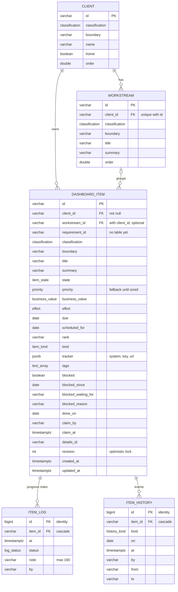

# Database

The Postgres tables behind dashboard items, as defined in
[src/db/schema.ts](../src/db/schema.ts) and created by the files in
[migrations/](../migrations). Drizzle also keeps its own record of applied
migrations in `drizzle.__drizzle_migrations`, which is not shown here.

## Tables and Relationships

`text_array` in the diagram is the Postgres type `text[]`. Mermaid cannot
show brackets in a type name.

| Relationship                   | Rule                                                                                                                               |
| ------------------------------ | ---------------------------------------------------------------------------------------------------------------------------------- |
| client to workstream           | Every workstream belongs to one client.                                                                                            |
| client to dashboard_item       | Every item belongs to one client (`client_id` is not null).                                                                        |
| workstream to dashboard_item   | Optional. The foreign key is on the pair (`workstream_id`, `client_id`), so an item can only be in a workstream of its own client. |
| dashboard_item to item_log     | Many notes per item. Deleting the item deletes its notes.                                                                          |
| dashboard_item to item_history | Many events per item. Deleting the item deletes its events.                                                                        |

## Rules the Database Enforces

These hold even for a writer that skips the JSON Schema validation.

- **Allowed values** are Postgres enums: `classification`, `item_state`,
  `priority`, `business_value`, `effort`, `item_kind`, `history_kind` and
  `log_status`.
- **Check constraints** on `dashboard_item` mirror the JSON Schema's
  cross-field rules:
  - the `id` is lower-case letters, digits and hyphens
  - blocked details are set only when `blocked` is true
  - `blocked_since` and `blocked_waiting_for` are set together
  - `done_on` is set only when `state` is `done`
  - `claim_by` and `claim_at` are set together
  - `revision` is 1 or more
- **The log and history are append only.** A trigger refuses `UPDATE` and
  `DELETE` on `item_log` and `item_history`. The one exception is the
  cascade when the item itself is deleted.
- **Writes are revision checked.** `updateItem` updates only where the
  revision still matches the one the writer read, and raises
  `RevisionConflict` when it does not.
- **An item's workstream belongs to the item's client.** The composite
  foreign key needs `workstream` to have a unique (`id`, `client_id`). With
  the default `MATCH SIMPLE`, a null `workstream_id` is not checked, so items
  without a workstream are allowed.

## Normalisation

The schema is in third normal form, with the deliberate exceptions listed
below. Each table describes one thing, and every column depends only on that
table's key.

- **Repeating groups have their own tables.** Progress notes and history
  events are rows in `item_log` and `item_history`, not arrays on the item.
  An item that runs for months does not grow a single field.
- **Clients and workstreams are stored once.** Items reference them by key,
  so renaming a client changes one row.
- **Derived values are not stored.** The computed priority, urgency, Covey
  quadrant and the today, tomorrow or future band are calculated on read
  (see [src/priority.ts](../src/priority.ts)). They cannot go stale, and
  changing the priority matrix needs no migration.

### Deliberate Exceptions

| Column(s)                                 | What it is                                                         | Why it stays                                                                                                                | When to change it                                                                                 |
| ----------------------------------------- | ------------------------------------------------------------------ | --------------------------------------------------------------------------------------------------------------------------- | ------------------------------------------------------------------------------------------------- |
| `blocked_*`, `claim_*`                    | The `blockedOn` and `claim` objects, flattened into columns        | An item has at most one of each, so a separate table adds a join and nothing else                                           | Not expected                                                                                      |
| `tracker` (jsonb)                         | `{system, key, url}` in one column                                 | One tracker per item, and nothing looks items up by tracker key yet                                                         | Move to a `tracker` table with a unique (system, key) when "find the item for a ticket" is needed |
| `tags` (text[])                           | Tags as an array                                                   | Filtering by tag is enough, and tags have no data of their own                                                              | Move to `tag` and `item_tag` tables when tags need a colour, an owner or a rename everywhere      |
| `requirement_id`                          | An identifier with no table behind it                              | Atlas has no requirements table to reference yet                                                                            | Add a `requirement` table and a foreign key when requirements exist                               |
| `classification`, `boundary` on every row | The same governance labels repeated on client, workstream and item | Atlas rule: each record carries its own label, so a row exported, logged or copied on its own is still marked correctly     | Do not remove                                                                                     |
| `client_id` on both item and workstream   | An item's client can be reached through its workstream too         | The workstream is optional, so the item needs its own `client_id`. The composite foreign key keeps the two from disagreeing | Not expected                                                                                      |
