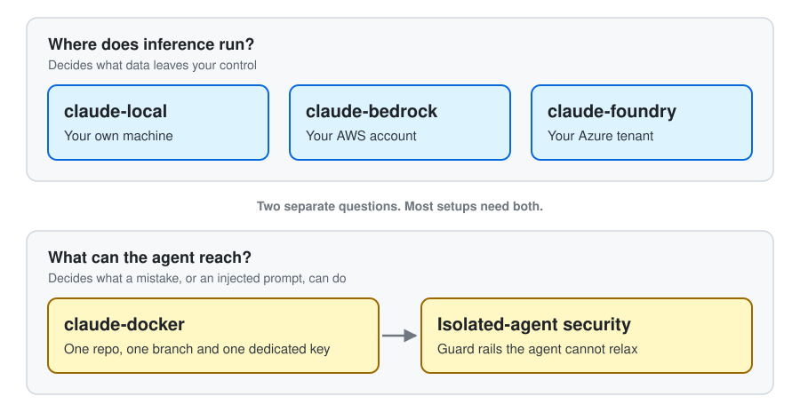
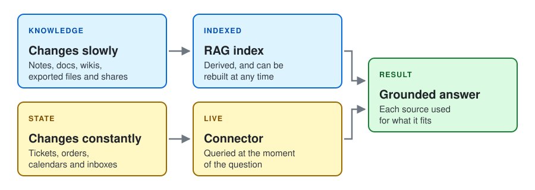
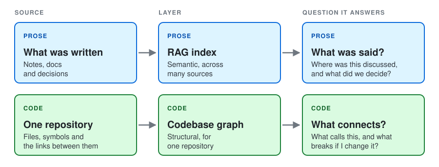
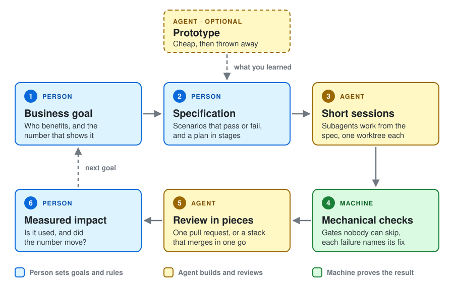

# Practices

[ai-toolkit](../README.md)

Patterns and operating models for working with Claude, across projects. Prose,
not config: the _how_ and _why_ of a way of working. Enforcement lives in the
other areas (security, privacy, plugins); this folder explains the shape they
add up to.

## Agent Isolation

An agent is useful in proportion to what it can reach, and dangerous in the same
proportion. No single setting resolves that, so the answer is layers, each one
holding when the one above it fails. Further reading:
[defence in depth for agents](https://www.lekman.com/blog/ai-security-defence-in-depth-for-agents).

Two questions are independent, and confusing them is the usual mistake:

- **Where does inference run?** This decides what data leaves your control.
- **What can the agent reach?** This decides what a mistake, or an injected
  prompt, can actually do.

Running Claude in your own AWS account answers the first and nothing about the
second: the agent still has your laptop. Putting it in a container answers the
second and nothing about the first. Most setups need both.

- [local-models/](local-models/README.md): run Claude Code against a model on
  your own machine via LM Studio's Anthropic-compatible endpoint, for work that
  must not leave the laptop. Installed and driven by
  [@lekman/claude-local](../packages/claude-local/README.md).
- [bedrock/](bedrock/README.md): run Claude Code on AWS Bedrock and keep the SSO
  session alive with a `SessionStart` auto-login hook, so a session never fails
  part way through on an expired token.
- [foundry/](foundry/README.md): run Claude Code on Claude in Microsoft Foundry
  (Azure), where there is no setup wizard and nothing checks the configuration
  before the first request, so pinning models and checking the Azure session
  are yours to do. Driven by
  [@lekman/claude-foundry](../packages/claude-foundry/README.md).
- [isolated-container/](isolated-container/README.md): give the agent a
  container holding one repository, one branch, and one dedicated credential,
  then stop asking it for permission: the boundary covers what the prompt was
  protecting. Driven by
  [@lekman/claude-docker](../packages/claude-docker/README.md).
- [security/isolated/](../security/isolated/README.md): the guard rails an agent
  must not be able to relax on its own, whether or not it sits in a container.

## Retrieval

What an agent can look up shapes what it can answer. Retrieval-augmented
generation adds a derived, searchable layer over knowledge sources (a
BI/warehouse layer for AI, queried just-in-time) while live state stays
behind APIs and connectors.

The split is the useful part. Knowledge that changes slowly is worth indexing.
State that changes constantly is not, and belongs behind a live query.

- [rag/README.md](rag/README.md): the mental model (fed like a warehouse,
  queried like a search index); why transactional data does not fit; when a
  live connector beats a pipeline. Design for the implementation in
  [packages/rag/DESIGN.md](../packages/rag/DESIGN.md).

## Meetings

Notes from meetings the meeting tool cannot or should not record: transcribe
on your own machine, then let an agent write the note. The privacy choice sits
between the two steps, so each client decides which model may read its
transcripts.

- [Meetings](meetings/README.md): local capture and transcription with
  Samurai Scribe or Meetily, the handling that keeps transcript text out of
  the session, the
  per-client local-only rule, and every copy left on disk. Driven by the
  [meeting plugin](../plugins/meeting/README.md).

## Codebase Graphs

Retrieval makes prose searchable. The equivalent for code is structural: a graph
of files, symbols, layers and the relationships between them, so an agent gets a
map before it edits rather than grepping its way to one.

The two layers answer different questions, and neither replaces the other.

Building a graph reaches further than most tasks, so it lands on both axes
above. It summarises every file in scope, which decides where inference must
run, and it fans out across the whole repository, which decides whether it
belongs in a container.

- [Codebase Graphs](graphs/README.md): when a graph pays for itself, how to
  scope and run one without overspending, which parts of the output to
  distrust, and how the run combines with local models and the isolated
  container.

## Context

What a session carries into every turn decides its cost and how much it can still hold. Trim the fixed part once, cap what enters, and let compaction remove the rest by role.

- [Context](context/README.md): what fills the window, compaction thresholds per role with settings templates, keeping state on disk so compaction loses nothing, and the habits that keep output out of the window.

## Orchestration

Isolation decides what one agent may do. Orchestration decides how many there
are and who holds the plan. Both docs below split the same way: something that
holds context and never touches code, and something disposable and narrowly
scoped that does.

- [orchestrator-subagent.md](orchestrator-subagent.md): split work between a
  planning orchestrator that never touches code and disposable, scoped
  subagents that each take one specified unit of work. The operating model
  behind [isolated-agent security](../security/isolated/README.md).
- [planning-handoff.md](planning-handoff.md): the retired model of planning in
  Claude Desktop and implementing in Claude Code through briefs committed to
  the repository. Kept as a record, with a note on why committed briefs were
  withdrawn.

## Engineering with Agents

Orchestration decides who holds the plan. It does not decide whether the
result is any good. An agent reports success with the same confidence either
way, so the work needs a written specification, evidence, and checks a
machine runs.

- [Engineering with Agents](engineering/README.md): the argument and the
  four rules behind the pages below.
- [Goals and Specifications](engineering/goals-and-specs.md): a business goal,
  behaviour written as scenarios, and a plan from a first working version to
  measured adoption.
- [Mechanical Checks](engineering/mechanical-checks.md): enforce the
  organisation's rules with gates nobody can skip, where every failure says
  what to change and links to its rule.
- [Prototypes](engineering/prototypes.md): explore cheaply with whiteboards
  and artifacts, then build production code from the specification.
- [Sessions and Subagents](engineering/sessions-and-subagents.md): short
  sessions, the specification as the handoff, one worktree per subagent, and
  one pull request or a stack made with `gh stack`.
- [Agent Code Review](engineering/code-review/README.md): set up Claude Code Review,
  GitHub Copilot and CodeRabbit with their own instructions, answer every
  comment, and resolve the threads.
- [Merge, Release and Ship](engineering/merge-release-ship.md): continuous
  integration, delivery and deployment as three separate events, with
  qualification and security tests on every release.
- [Source Security Audit](engineering/source-security-audit.md): agents
  audit the source of each release commit, the records stay with the
  release, and a confirmed finding blocks production.
- [Skill Feedback](engineering/skill-feedback.md): correct a skill when it
  fails, log every outcome, and rank the failures before deciding what to
  change.
- [Third-Party Skills](engineering/third-party-skills.md): queue, read,
  isolate and evaluate a skill someone else wrote before installing it.
- [Vetting Record for the Security Audit Skill](engineering/security-audit-skill-vetting.md):
  one skill taken through those steps, as a worked example.

## An Agent-Operated Notes Vault

Where the working notes live and how an agent maintains them. Obsidian holds
the markdown; Claude Code runs inside the vault (via the ObsidiBot plugin)
and does the filing, the daily plan and the recurring documents. The value is
written conventions, not plugins: a frontmatter schema, one folder and one
dashboard group per client, and skills for anything written the same way
three times.

- [Obsidian as an Agent-Operated Workspace](obsidian/README.md): the full
  practice, from vault settings to conventions, the dashboard method, the
  agent layer underneath, and the cautions (iCloud races, secrets, client
  separation as a contractual matter).

## A Live Work Dashboard

The vault holds the plan; a dashboard shows it next to what each client's own
systems say, and keeps itself current. It is a Claude artifact, so most of it
refreshes from page code with no AI run in the loop.

- [live-dashboard/README.md](live-dashboard/README.md): a per-client page of
  meetings, worklist and trackers (the
  [Atlas](https://github.com/lekman/atlas) sidebar), fed three ways: live connectors, a
  scheduled sync that keeps secrets on your computer, and a local MCP server
  for code-only checks such as release drift.

## Observability

Isolation and orchestration decide what the agent may do and who holds the plan.
Neither tells you what it is doing right now. An agent you cannot see is one you
end up watching instead of working alongside.

- [observability/README.md](observability/README.md): notifications first, since
  knowing when to look is what makes watching optional. Three techniques by
  distance from the keyboard: built-in remote control, Pushover for long runs,
  and a local sound cue tuned so it means _look now_. Progress and access
  visibility are named but not yet built.
