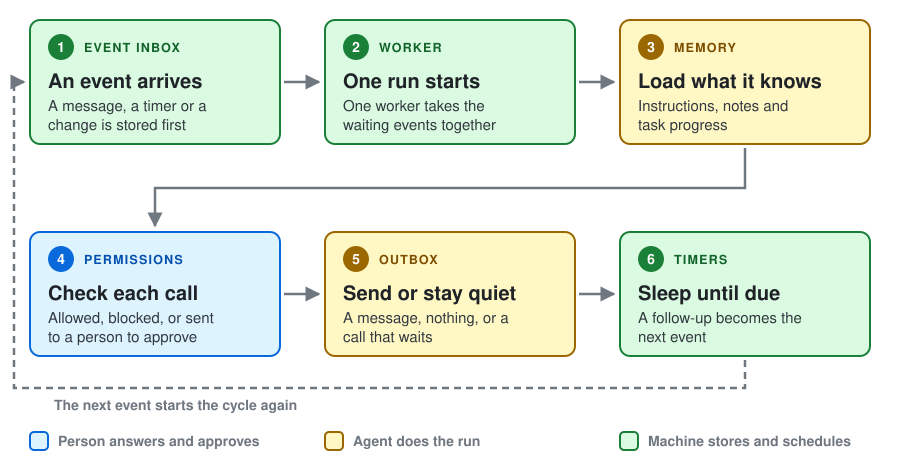

# Always-On Agents

[ai-toolkit](../../README.md) / [Practices](../README.md)

An always-on agent sleeps, wakes when something happens, does one piece of
work, saves what happened and sleeps again. This page checks the toolkit
against Anthropic's article
[Building always-on agents](https://claude.com/resources/articles/building-always-on-agents)
(13 Nov 2026), part by part, and records what was measured. It is for someone
who runs several Claude Code sessions at once and wants to know which parts
of that design they already have.

The article uses two words with care. A **run** is one stretch of work, in
which the agent receives an event, completes its task and saves what
happened. A **session** is the transcript of messages and tool calls that a
run works inside.

## Workflow

The six steps as text

1. **Event inbox.** An event arrives. A message, a timer or a change is
   stored before anything acts on it.
2. **Worker.** One run starts. One worker takes the events that are waiting,
   together.
3. **Memory.** The agent loads what it knows: instructions, notes and task
   progress.
4. **Permissions.** Each tool call is allowed, blocked, or sent to a person
   to approve.
5. **Outbox.** The run ends with a message, with nothing, or with a call
   that waits for an answer.
6. **Timers.** The agent sleeps until a follow-up is due. The follow-up
   becomes the next event, and the cycle starts again.

A person answers and approves. The agent does the run. The machine stores
and schedules.

## What the Toolkit Has for Each Part

| Part        | What exists                                                                                                                                                                                         | Where                                                                                                                                   |
| ----------- | --------------------------------------------------------------------------------------------------------------------------------------------------------------------------------------------------- | --------------------------------------------------------------------------------------------------------------------------------------- |
| Event inbox | A `message` table in the tasks server. Hooks hand new messages to a session at start, at each prompt and at stop. A watcher wakes an idle session. GitHub changes go to a log and move task states. | [tasks](../../plugins/tasks/README.md), [Commander](../../plugins/commander/README.md), [gh-events](../../packages/gh-events/README.md) |
| Timers      | `CronCreate` jobs inside one session, scheduled tasks in the desktop app, and a detached timer behind `notify ask`.                                                                                 | [Sessions and Subagents](../engineering/sessions-and-subagents.md)                                                                      |
| Memory      | Standards loaded through `CLAUDE.md`, a memory folder with an index, the task database and the vault.                                                                                               | [Standards](../../standards/README.md), [Context](../context/README.md)                                                                 |
| Permissions | Permission modes and guard hooks. A hook that turns a question into an Atlas question and returns the answer as a message.                                                                          | [Security](../../security/README.md), [Commander](../../plugins/commander/README.md)                                                    |
| Outbox      | A push to the phone, once for each key in a time window and held in quiet hours. Links from the share plugin.                                                                                       | [Observability](../observability/README.md), [Commander](../../plugins/commander/README.md)                                             |

## Checked Against the Article

Each row is a statement the article makes about a correct always-on agent.
Two are marked inferred, because the article implies them and does not state
them. The ratings were set on 28 Nov 2026 at commit `21d136d`.

- **Meets** means a test passed, or the code does it and a test confirms it.
- **Partly** means it holds in some cases, and the row names where it fails.
- **Missing** means a test showed that it does not hold.

| Id  | Part        | Property                                                                      | Rating  | What showed it                                                                                                                                                                         |
| --- | ----------- | ----------------------------------------------------------------------------- | ------- | -------------------------------------------------------------------------------------------------------------------------------------------------------------------------------------- |
| P1  | Inbox       | Each event has a status that is tracked until its run is done                 | Partly  | A message reached an idle session 29 seconds after it was sent. It is marked delivered when it is shown, before the session acts (`deliver.ts` lines 59 to 61).                        |
| P2  | Inbox       | Events are deduplicated by the source's own identifier                        | Partly  | `gh-events` gives each event a key from its source (`diff.ts` line 129). A message has no such key, and the same text sent twice was shown twice.                                      |
| P3  | Inbox       | One active worker for each inbox                                              | Missing | Two sessions with one name, called at the same moment, both took the same message in 6 of 6 tries. Called in turn, only the first took it.                                             |
| P4  | Inbox       | Events that are pending are batched into one run                              | Meets   | Two waiting messages arrived in one hook call.                                                                                                                                         |
| P5  | Inbox       | An event is retried when the worker dies during its run (inferred)            | Missing | A message shown at stop was not shown again to the same session, or to a new session with the same name.                                                                               |
| P6  | Inbox       | A reply resumes its session, and any other event starts a new one             | Partly  | A message reaches a named session. Nothing starts a session for an event, and a watcher whose time was up did not wake its session. The default time is 55 minutes.                    |
| P7  | Timers      | Timers live in their own durable store                                        | Partly  | A scheduled task is a file on disk. A `CronCreate` job lives in its session. It came back when a headless session was resumed, and no other session can see it.                        |
| P8  | Timers      | A timer that is due adds an event to the inbox and never starts a run         | Missing | A scheduled task started a new session. That run saw no earlier conversation, no code word from the session that made it, and no jobs.                                                 |
| P9  | Timers      | A follow-up is marked done when it fires                                      | Meets   | The one-time task fired 0.7 seconds after it was due and then turned itself off.                                                                                                       |
| P10 | Timers      | A timer survives a restart (inferred)                                         | Partly  | A pending question was still pushed after its detached timer was killed, once `notify due` ran. A scheduled task that is due while the app is closed was not tested.                   |
| P11 | Memory      | Memory is in durable storage outside the worker                               | Partly  | The task database and the vault are shared. The memory folder is on one machine, under that machine's project path.                                                                    |
| P12 | Memory      | Memory keeps what cannot be looked up again, and a pointer for the rest       | Partly  | Of 26 entries, 13 held what no other record has. The other 13 copied a system of record, and 8 of the 26 disagreed with it.                                                            |
| P13 | Memory      | The user's instructions load at the start of every run                        | Meets   | `standards/CLAUDE.md` imports nine files, and a new session had them before its first turn. They load from the main checkout, so a merged change waits until that checkout is updated. |
| P14 | Memory      | A separate pass curates old memory                                            | Partly  | Skills for it exist. No scheduled task runs one.                                                                                                                                       |
| P15 | Permissions | The agent never holds credentials, and a proxy adds them                      | Missing | Hooks read a token from the environment or the Keychain (`ask.system.ts` line 210). The container mounts one key read-only, and the agent can use it.                                  |
| P16 | Permissions | Each tool call is allowed, blocked or sent for approval                       | Meets   | `.claude/settings.json` has deny and ask lists and a hook before tool use.                                                                                                             |
| P17 | Permissions | A deferred call ends the run, the session is saved, and the answer resumes it | Partly  | The hook refuses the question and tells the agent to keep working (`no-ask.ts` line 123). It covers questions only. With no Atlas address set, it lets every question through.         |
| P18 | Outbox      | A dispatcher delivers pending messages                                        | Partly  | A second push with the same key in the window was skipped. Two sessions that reported one event under two keys both pushed.                                                            |
| P19 | Outbox      | Message volume is tuned with evals, starting quiet                            | Missing | Volume was measured for the first time for this page. Nothing tunes it.                                                                                                                |
| P20 | Context     | The context that every run loads is kept small                                | Missing | A desktop session started at a median of 116,331 tokens. About 5% of that was the operator's own instructions.                                                                         |

The inbox rows rest on live tests against the tasks server with test
receiver names. The outbox rows rest on dry runs of `notify.ts`. The rest
rest on the code and on the Commander plugin's own 57 tests, which pass.

## Measured Baseline

The numbers come from one operator's machine on 28 Nov 2026. The article
gives no thresholds, so none is claimed here.

### Context at Session Start

| Where the session ran                  | Sessions in seven days | Median tokens at the first turn | Range             |
| -------------------------------------- | ---------------------- | ------------------------------- | ----------------- |
| Desktop app                            | 42                     | 116,331                         | 58,678 to 136,641 |
| VS Code                                | 7                      | 59,170                          | 56,611 to 65,748  |
| Command line, one new headless session | 1                      | 40,100                          | One sample        |

One desktop session that started at 124,465 tokens was split by source. The
parts are estimates at four characters for each token.

| Source                                                  | Tokens | Share | Decision                                                 |
| ------------------------------------------------------- | ------ | ----- | -------------------------------------------------------- |
| The app's system prompt and the tools it loads in full  | 78,000 | 63%   | Keep. It is not the operator's to change.                |
| The list of tool names that load on demand              | 14,500 | 12%   | Cut. Turn off connectors that coding sessions never use. |
| The prompt snapshot                                     | 11,000 | 9%    | Keep. Its content was not examined.                      |
| The list of skills                                      | 9,600  | 8%    | Cut. Turn off plugins that this repository does not use. |
| Instruction files: standards, `CLAUDE.md`, memory index | 5,900  | 5%    | Keep, and remove memory entries that repeat a standard.  |
| Server instructions and the list of agents              | 4,800  | 4%    | Keep.                                                    |

The first row is what is left after the others are counted. The list of tool
names held 1,066 names, and three connectors that no coding session used
held 586 of them.

The headless session reported its own split: 12,300 tokens of system tools,
10,700 of memory files, 10,000 of skills, 2,900 of system prompt and 2,600
of server instructions.

### Messages to the Operator

In seven days the sessions on this machine ended 919 turns with a message.
The operator started 398 of those turns. Something else started 474: a
background command that finished (214), another session (96), a pull request
event (72), a system reminder (48) or a note from a session it had started
(44).

A sample of 50 of the 474 was labelled with a written rule.

| Label      | Count | Meaning                                                              |
| ---------- | ----- | -------------------------------------------------------------------- |
| New        | 38    | A result, a new fact, a decision to make or a blocker                |
| Not needed | 12    | Nothing changed, still waiting, or an event that needed no attention |
| Repeat     | 0     | Restates the message before it and adds nothing                      |

Five of the 12 restated an earlier status as well. The rule put them under
"not needed" because they also said that the session was still waiting.
Eight labels were marked unsure. A sample of 50 gives a wide margin, so read
12 in 50 as roughly one in four, with a range of about one in eight to one
in three.

### Lost Follow-Ups

Four sessions were started by another session in 14 days, all on one day.
They had six idle gaps of more than 20 minutes.

| Gap in minutes | What the session was waiting for                  | Lost |
| -------------- | ------------------------------------------------- | ---- |
| 257            | A background command, with work not yet committed | Yes  |
| 162            | Nothing. Its pull request was open                | Yes  |
| 148, 109, 24   | Nothing. Its work had merged                      | No   |
| 26             | A background command, which then woke it          | No   |

No check-in was scheduled when the two lost gaps began. The operator ended
both.

### From a Pull Request Event to a Reaction

| Path                                            | Events matched | Seconds from GitHub's time |
| ----------------------------------------------- | -------------- | -------------------------- |
| Auto-fix in the desktop app wakes the session   | 5              | 32, 46, 66, 73 and 441     |
| `gh-events` writes the event and moves the task | 2              | 37 and 54                  |

`gh-events` calls two tools on the tasks server, `task_search` and
`task_update`. It sends no message, so without Auto-fix no path leads from a
pull request event to a session. That case was not timed on a live pull
request.

### Memory Against the Pointer Rule

| Decision                                                            | Entries | Bytes  |
| ------------------------------------------------------------------- | ------- | ------ |
| Keep: no other record holds it                                      | 13      | 18,551 |
| Make a pointer: a README, a rule or a note holds it                 | 8       | 12,655 |
| Delete: a standard that already loads says it, or it is out of date | 5       | 8,623  |

Eight entries disagreed with the record they copied. In three of them a
standard had moved on and the memory still held the older rule. In two the
plugin that the entry described had been replaced.

## Scoring What to Build

Each candidate got 0 to 2 on four questions. A total of 6 or more is worth a
design, 4 or 5 is for later, and less than 4 is dropped.

| Candidate                | Gap | How often | No feature covers it | Small build | Total | Result  |
| ------------------------ | --- | --------- | -------------------- | ----------- | ----- | ------- |
| Told-the-operator record | 2   | 2         | 2                    | 2           | 8     | Design  |
| Outbox with pacing       | 2   | 2         | 2                    | 1           | 7     | Design  |
| Durable timers           | 2   | 1         | 1                    | 1           | 5     | Later   |
| GitHub events to inbox   | 1   | 0         | 1                    | 2           | 4     | Later   |
| Credential proxy         | 2   | 0         | 1                    | 0           | 3     | Dropped |

The scores need two cautions.

- The two highest share one measure, the 12 messages in 50 that were not
  needed. Those were messages at the end of a turn in the app. Neither
  candidate sits in that path today, because the outbox in this toolkit
  carries pushes, and this machine sent none. A rule on when to report costs
  nothing to try, so it comes first, and the measure is taken again before
  either is designed.
- Durable timers score lower because the baseline holds one day of sessions
  that were started by another session. The two lost gaps on that day cost
  seven hours between them.

## Changes That Need No Code

1. **Pointer rule.** Shrink or remove the 13 memory entries that copy a
   record. Fix the 8 that disagree with it first.
2. **Smaller start.** Turn off the connectors and plugins that a coding
   session does not use, then measure the start again.
3. **Start quiet.** A session that wakes on an event reports only a result,
   a decision or a blocker. "Still waiting" is not a report.
4. **One owner.** One session answers for a pull request. Other sessions send
   it a message.
5. **Batch.** A session that receives several notes in one turn answers once.

## What the Tests Also Found

- **A headless run does not exit while the watcher waits.** A `claude -p`
  run with the Commander plugin on was still alive 170 seconds after its
  answer. With `ASK_WATCH=off` the same session exited in 11 seconds.
- **A resumed session keeps its `CronCreate` job.** The tool says a job is
  gone when Claude exits. A job made in a headless session was listed again
  after the process was stopped and the session resumed. It cannot fire
  while no process runs.
- **A scheduled task runs in the main checkout.** The run's working directory
  was the repository's own folder and not a worktree.
- **The question hook needs an Atlas address.** On a machine with none set,
  `AskUserQuestion` works as it does without the hook.

## Limits of These Numbers

- One machine, one operator and one week. Sessions on other machines are not
  counted.
- The message labels were made by an agent from a written rule. The
  operator's check of 10 labels was still open when this page was written.
- The split of the desktop session's start is an estimate from character
  counts. Only the total is measured.
- Not tested: a scheduled task that is due while the app is closed, a live
  round trip through Atlas, and a pull request with Auto-fix off.

## References

- [Building always-on agents](https://claude.com/resources/articles/building-always-on-agents),
  Anthropic, 13 Nov 2026. The article says to build evals for message volume
  and to start quiet. It gives no method, metric or threshold, so the
  measures and the scoring on this page are this toolkit's own.
- [Sessions and Subagents](../engineering/sessions-and-subagents.md): the
  check-in on a clock is the timers part.
- [Commander](../../plugins/commander/README.md): the hooks behind the inbox,
  the question hook and the push.
- [Context](../context/README.md): what fills the window, and how to keep it
  small.
