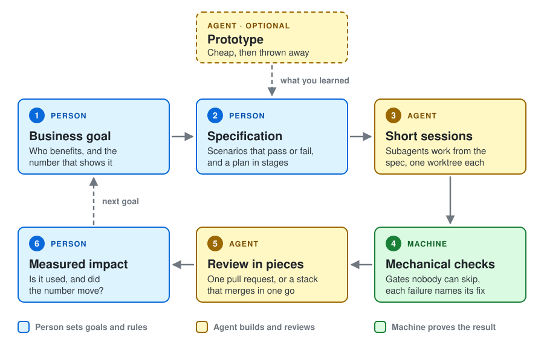

# Engineering with Agents

[ai-toolkit](../../README.md) / [Practices](../README.md)

How to get dependable software from a coding agent. This section is for an
engineer or a lead who uses agents on production code and wants the result to
hold up in review, in operation and in an audit.

An agent writes code quickly, and it reports success with the same confidence
whether the work is right or wrong. Treating that report as proof is the same
mistake as accepting an employee's word in place of a test. The method here is
the one engineering already uses for people. Write down what is wanted, decide
what evidence proves it, and let a machine run the checks.

## Workflow

The steps in detail

The colour of each step shows who owns it. A person sets the goal and the
rules, agents build and review, and a machine proves the result. No agent
reviews its own work.

1. **Business goal.** A person names who benefits and the number that will
   show it. Without that number, step 6 has nothing to read. See
   [Goals and Specifications](goals-and-specs.md).
2. **Specification.** A person writes the behaviour as scenarios that pass or
   fail, and plans the stages from a first working version to measured
   adoption. An optional prototype answers one open question cheaply. What it
   showed goes into the specification, and its code is thrown away. See
   [Prototypes](prototypes.md).
3. **Short sessions.** Agents do the work. Each subagent takes one unit from
   the specification, works in its own worktree, and ends its session when
   the unit is done. See [Sessions and Subagents](sessions-and-subagents.md).
4. **Mechanical checks.** Lint rules, tests and gates decide what is
   accepted, and neither an agent nor a person can skip them. A failed check
   says what to change and links to its rule. The agent's own report of
   success is a claim, and nothing is accepted on it. See
   [Mechanical Checks](mechanical-checks.md).
5. **Review in pieces.** Small work arrives as one pull request. Large work
   arrives as a stack made with `gh stack`, where each piece is reviewed
   alone and the whole stack merges in one operation. Reviewer agents read
   each piece and every comment gets a reply. A written policy then approves
   it, and a person approves only where the risk calls for one. A merge is
   not a shipment, and
   [Merge, Release and Ship](merge-release-ship.md) covers what follows.
   See [Agent Code Review](code-review/README.md).
6. **Measured impact.** After release, a person reads the goal's number.
   Whether the work is used, and whether the number moved, sets the next
   goal.

## The Pages

- [Goals and Specifications](goals-and-specs.md) starts the work from a
  business goal, writes behaviour as scenarios, and plans the stages from a
  first working version to measured adoption.
- [Mechanical Checks](mechanical-checks.md) enforces the organisation's
  rules with gates nobody can skip, where every failure says what to change.
- [Prototypes](prototypes.md) keeps exploration cheap and separate, then
  builds production code from the specification.
- [Sessions and Subagents](sessions-and-subagents.md) keeps sessions short,
  hands work over through the specification, and delivers pieces a person
  can review.
- [Agent Code Review](code-review/README.md) gives each reviewer agent its own
  instructions, answers every comment, resolves the threads, and lets the
  risk of a change decide who approves it.
- [Merge, Release and Ship](merge-release-ship.md) keeps the three events
  apart, so a merge can be automatic and the heavy testing happens where
  the software runs.
- [Source Security Audit](source-security-audit.md) has agents audit the
  source of each release commit, keeps the records with the release, and
  blocks production on a confirmed finding.
- [Skill Feedback](skill-feedback.md) corrects a skill when it fails, logs
  outcomes over time, and uses a failure analysis to decide what to change.
- [Third-Party Skills](third-party-skills.md) queues a skill someone else
  wrote, reads it, runs it in isolation and evaluates the result before it is
  installed.

## Four Rules Behind Every Page

1. **State lives in the specification and the tracker.** What is wanted, what
   is done and what is left are written where a person maintains them. Text
   that one agent writes for another agent is working material, and it is
   never committed.
2. **A machine proves the work.** A linter, a test or a gate decides whether a
   rule was followed. An agent saying it followed the rule is a claim.
3. **A person makes the engineering decisions.** Architecture, trade-offs and
   scope are decided by someone accountable and recorded where the next
   engineer finds them. Deciding is different from approving each change. Who
   approves follows the risk, and on many repositories that is a policy.
4. **Measure before you believe.** Cost, speed and quality claims about a way
   of working are tested against your own numbers, including the claims on
   these pages.

## What This Replaces

A common way to scale agent work is to run many of them for long periods, each
handing work to the next in prose. The handover notes, plans and status
reports are committed with the code, and the run is left overnight.

The costs I have seen from that pattern are these:

- **Token spend grows with the number of agents.** Each agent carries its own
  context, so shared reading is paid for once per agent.
- **Engineering decisions disappear.** A decision made inside a long agent
  exchange is recorded nowhere a person would look.
- **Generated prose becomes a rule.** A handover note that contains an error
  is read by the next agent as fact. Once committed, it can block correct
  work later.
- **Review stops working.** A pull request with thousands of changed lines and
  pages of generated description cannot be reviewed, so it is approved
  unread.
- **The outcome is unknown until morning.** Nobody watched the run, so a wrong
  turn early is paid for all night.

These are observations from a small number of repositories, so treat them as
claims to test. [Skill Feedback](skill-feedback.md) describes the log that
would give you your own numbers.

Running several agents is still useful.
[Orchestrator and Subagents](../orchestrator-subagent.md) describes how, and
it follows the same four rules.
