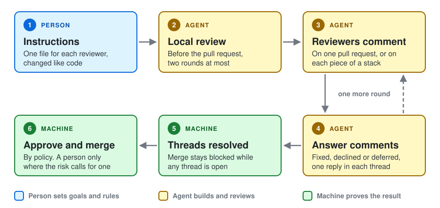

# Agent Code Review

[ai-toolkit](../../../README.md) / [Practices](../../README.md) / [Engineering with Agents](../README.md)

Reviewer agents read every pull request, and on many repositories no person
does. Give each reviewer its own instructions, answer every comment it
leaves, resolve the threads, and let the risk of the change decide who
approves.

Tool behaviour on this page is from each vendor's documentation, read on 28
Nov 2026. File names and settings change between releases, so check the linked
pages before you rely on one.

## Workflow

The steps in detail

1. **Instructions.** A person writes one instruction file for each reviewer.
   It says what to skip, what a check already enforces, where to look
   closely, how deep to go and how to write. A change to it is reviewed like
   a change to code.
2. **Local review.** The coding agent runs a reviewer on its own work before
   the pull request opens, fixes what is real, and runs it once more. It
   stops after two rounds.
3. **Reviewers comment.** The work arrives as one pull request, or as a
   stack where each piece is reviewed alone. Every reviewer reads it under
   its own instructions. See
   [Sessions and Subagents](../sessions-and-subagents.md) for stacks.
4. **Answer comments.** Each comment gets one reply in its own thread, as
   fixed, declined or deferred. No reviewer reviews a new push by itself.
   The author asks for one more review after the fixes, and the pull
   request stops at two rounds.
5. **Threads resolved.** A branch ruleset blocks the merge while any thread
   is open, so no comment can be passed over.
6. **Approve and merge.** A written policy approves once the gates pass and
   the threads are resolved. A person approves only where the risk calls for
   one, such as a change to the guardrails themselves.

## The Practice

### Give Every Reviewer Its Instructions

A reviewer agent with no instructions comments on everything it can. It flags
generated files, repeats what the linter already said, and reviews release
pull requests that hold nothing but a version number. People then skim its
output, and the one comment that mattered is skimmed with the rest.

Never turn on a reviewer without its instruction file. Each tool reads shared
project files and a file of its own.

| Tool               | Shared files it also reads                                  | Its own review file                                                            |
| ------------------ | ----------------------------------------------------------- | ------------------------------------------------------------------------------ |
| Claude Code Review | `CLAUDE.md`                                                 | `REVIEW.md` at the repository root                                             |
| GitHub Copilot     | `AGENTS.md`, `CLAUDE.md`, `REVIEW.md`                       | `.github/copilot-instructions.md` and `.github/instructions/*.instructions.md` |
| CodeRabbit         | `AGENTS.md`, `CLAUDE.md`, `.github/copilot-instructions.md` | `.coderabbit.yaml` at the repository root                                      |

Keep conventions that every agent needs in the shared files, so they are
written once. Keep review behaviour in each tool's own file. Every review
file should answer the same five questions.

1. **What to skip.** Generated code, lock files, and pull requests that are
   machine made, such as release and dependency updates.
2. **What a check already enforces.** Tell the reviewer not to comment on
   formatting, import order or anything else that fails the build by itself.
   See [Mechanical Checks](../mechanical-checks.md).
3. **Where to look closely.** Name the parts where a mistake is expensive,
   such as authentication, money, migrations or published packages.
4. **How deep to go.** Set a limit on minor remarks, and say which severity
   is worth a comment at all.
5. **How to write.** Language, length and tone of the comments.

### Set Up Each Reviewer

Each reviewer has its own page, with the setup steps and an example of its
instruction file.

- [Claude Code Review](claude-code-review.md) is a managed service. It reads
  `REVIEW.md` from a branch the pull request cannot change.
- [GitHub Copilot Review](copilot-review.md) is turned on by a ruleset. It
  reads its instructions from the branch under review.
- [CodeRabbit](coderabbit.md) reviews pull requests, commits in the editor,
  and local changes from the command line or from a coding agent.

### Answer Every Comment

Each comment gets its own reply, in its own thread. A reply is one or two
lines and takes one of three forms.

- **Fixed**, with the commit that fixed it.
- **Declined**, with the reason.
- **Deferred**, with a link to the issue that now holds it.

Do not answer ten comments with one summary at the bottom of the pull
request. The reply belongs beside the line it concerns, where the next reader
of that line will find it.

An agent may write these replies, and the same limits apply. A reply states
the outcome. It does not start a conversation with the reviewer.

### Resolve When Done

Resolve each thread once its reply is posted. A resolved thread is collapsed
and kept, so anyone can expand it later. When every thread from one review is
resolved, hide that review's summary comment as resolved too. A pull request
with fifteen open review blocks tells the next reader nothing about what is
still outstanding.

Each tool handles its own threads differently.

- **Claude Code Review** resolves its earlier thread on the next review when
  it judges the problem fixed.
- **CodeRabbit** resolves all of its threads when someone posts
  `@coderabbitai resolve` as a top-level comment. Reply to each thread first,
  because the command closes them whether or not they were answered.
- **Copilot** threads are resolved by hand or through the API. I found no
  documented command for it.

Doing this through the GitHub API

The GitHub GraphQL API has a mutation for each step, so an agent can do the
whole of this with the `gh` command line tool.

| Step                  | Mutation                          | Needs                                         |
| --------------------- | --------------------------------- | --------------------------------------------- |
| Reply in a thread     | `addPullRequestReviewThreadReply` | The thread's ID and the reply text            |
| Resolve the thread    | `resolveReviewThread`             | The thread's ID                               |
| Hide a review summary | `minimizeComment`                 | The review's ID and the classifier `RESOLVED` |

### Approve by Risk

A person's approval is not a requirement of this practice. Many repositories
merge with no human reviewer, and they are safer for it when the conditions
below hold.

A person who approves a change they cannot judge is a meat proxy. Their name
is on the decision, and either a machine made it or nobody did. That approval
adds nothing in four cases.

- **No skill.** The reviewer cannot judge this kind of change.
- **No time.** The reviewer is the bottleneck, and ends up approving unread.
- **No evidence.** The reviewer cannot see what ran, what passed and what the
  change touched.
- **Evidence that can be changed.** What the reviewer sees may differ from
  what ran.

In each case automated guardrails give more assurance than the approval did.
So choose who approves by what a mistake would cost.

| The change                                                                    | Who approves                                     |
| ----------------------------------------------------------------------------- | ------------------------------------------------ |
| Cheap to undo and covered by checks, such as a release or a dependency update | Policy alone                                     |
| Product code with tests, gates and reviewer agents                            | Policy, once gates pass and threads are resolved |
| The guardrails themselves, such as checks, rulesets and reviewer instructions | A named person                                   |
| Hard to undo, or one a regulation says a person must sign                     | A named person with the skill and the evidence   |

Removing the person is sound only while four things hold. The fourth case
above applies to automation as much as to people.

1. **The author cannot change the gate.** Checks, hooks, rulesets and
   reviewer instructions need an approval the author cannot give itself.
2. **The approver is not the author.** A separate identity approves, and the
   setup fails when the two are the same.
3. **The evidence is made where the author cannot edit it.** A required
   check on a protected runner counts. The agent's own report does not.
4. **The policy is code.** It names the authors, labels and paths it
   approves, a person owns it, and each approval leaves a record.

Approving a merge is also not approving a shipment, provided the two are
separate steps. Where a merge changes the main branch, nothing deploys from
it and nobody uses the branch directly, a merge puts nothing in front of a
user, and the heavy tests run later against the deployed release. In a
repository that deploys on merge, approving the merge is approving the
shipment. The same holds where others run the main branch as it is, such as
a shared workflow or action that callers pin to the branch name. See
[Merge, Release and Ship](../merge-release-ship.md).

The person does not leave. They stop approving each change and own the
rules instead, which are the specification, the gates and the policy. Count
the defects found after merge, and move a kind of change up a row when that
count rises.

Approving without a person on GitHub

- **A ruleset** requires passing checks, resolved threads, one approving
  review, and review from code owners. It also dismisses an approval when
  new commits are pushed. Without that, an approval given before a later
  push still counts for the commits that came after it.
- **A second GitHub App** gives that review when the policy's conditions
  hold. GitHub refuses a review from a pull request's own author, so the
  approver must be a different identity from the one that opened it.
- **Code owners** decide which paths the app may approve alone. A path owned
  by a person still waits for that person, but only while the ruleset
  requires review from code owners. Without that setting the app's approval
  is enough for every path.
- **Claude Approvals**, in public beta for Team and Enterprise plans, is a
  pull request check driven by a policy file at `.claude/approvals.yml`.
  Each rule names paths and says whether Claude or a person must approve.
  See [Claude Approvals](https://code.claude.com/docs/en/approvals.md).

### Limit the Rounds

A round is one pass in which a reviewer asks for changes, and the fixes for
it. Stop after two rounds. The limit applies to a local review before the
pull request opens, and again to the reviewers on the pull request.

1. **Round one** reviews the work. The agent checks each finding against the
   code and fixes the real ones.
2. **Round two** confirms the fixes and catches what they broke.

Anything still open after round two gets a reply and goes to a person. Do
not loop until the reviewer returns nothing. A reviewer does not give the
same answer twice, so each run can raise a new minor remark and the loop may
never end. Each run also spends from a rate limit or a budget.

One round is enough for a small change whose fixes are mechanical.

On a pull request the loop can run with nobody in it. A reviewer set to
review each push comments on every fix. A coding agent set to fix every
comment pushes after every review. Each one then starts the other, and the
rounds continue until a rate limit or a budget stops them. Turn off review
of each new push for every reviewer, so that a reviewer reviews once when
the pull request opens and the author asks for round two once, after the
fixes.

| Reviewer           | Review once                                   | Ask for round two              |
| ------------------ | --------------------------------------------- | ------------------------------ |
| Claude Code Review | Set "Review runs" to "Once after PR creation" | Comment `@claude review`       |
| GitHub Copilot     | Leave "Review new pushes" off in the ruleset  | Request Copilot as a reviewer  |
| CodeRabbit         | Set `auto_incremental_review: false`          | Comment `@coderabbitai review` |

A reviewer's replies in a thread count as a pass. Some reviewers answer
each reply, check the fix and ask for more. Turning off review of each push
does not stop that, because the reviewer is answering a reply and no push
is involved. On this repository one pull request had its review, then
three more exchanges in its threads, with review of each push turned off.
The first exchange found two real gaps. The second asked for something out
of scope and was withdrawn in the third.

Count the first set of replies that ask for more as round two, and do not
also ask for a second review. That holds whether or not a fix was pushed in
between. After round two the coding agent replies once in each thread that
asks for a change, gives its reason, and pushes no fix. It does not answer a
reply that only confirms or withdraws.

These settings stop a reviewer from starting a round by itself. Nothing
counts the rounds that someone asks for or the replies in a thread, so the
limit of two is a rule the author and the coding agent keep.

Check every finding before acting on it. A reviewer's finding is a claim,
the same as an agent's report of success.

## Why

A reviewer agent is cheap to turn on and expensive to leave untuned. Every
comment costs a person's attention, and attention spent on noise is taken
from the findings that matter.

The instruction file is prose, so the reviewer can ignore it. When a
reviewer raises the same finding in three pull requests, the finding belongs
in a linter rule and the instruction file should then tell the reviewer to
stop reporting it.

A reply on each thread is the record of a decision. "Declined, because this
path is covered by the integration test" tells the next engineer more than a
resolved thread with no answer.

Other pages in this section keep text that agents write for agents out of the
repository. Review replies are the one place it is allowed, and they are
bounded. Each is short, attached to a line of code, and collapsed when the
thread is resolved.

## The Failure It Prevents

- Review comments that nobody reads because most of them are noise.
- A finding that was dismissed with no reason recorded.
- A merged pull request with a dozen open review blocks, where nobody can
  tell which were handled.
- A pull request that edits the reviewer's instructions to pass its own
  review.

## How It Is Enforced

- A branch ruleset requires every review thread to be resolved before a
  merge. An unanswered comment then blocks the pull request.
- The same ruleset requests a Copilot review of each pull request whose
  author has access to Copilot. It does not hold the merge until that review
  has posted.
- Instruction files are covered by code owners, and the ruleset requires
  review from code owners, so a change to them needs approval from a person.
  That holds for a change pushed after the approval only where the ruleset
  dismisses stale approvals.
- A second app approves the kinds of change the policy names, and the
  approving job fails when the approver and the author are the same.

This repository uses all four. Its ruleset sets
`required_review_thread_resolution` and carries a `copilot_code_review` rule,
and its `.github/copilot-instructions.md` tells Copilot to skip release and
dependency pull requests. Its release pull requests are approved by a
second app when the author, the label and every changed path match, and no
person reads them. Its ruleset does not dismiss stale approvals, so here an
approval given before a later push still counts. It has no `REVIEW.md`, and
Claude Code Review is not installed here. Neither reviewer reviews a new
push by itself. The Copilot rule in the ruleset sets `review_on_push` to
false, and `.coderabbit.yaml` sets `auto_incremental_review` to false.
