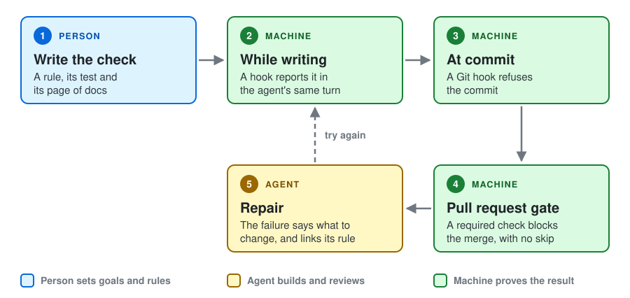

# Mechanical Checks

[ai-toolkit](../../README.md) / [Practices](../README.md) / [Engineering with Agents](README.md)

Every organisation has rules its code must follow. Enforce them with checks
and gates that neither an agent nor a person can skip, and make every failed
check say exactly what to change.

## Workflow



<details>
<summary>The steps in detail</summary>

1. **Write the check.** A person turns a rule into a check, with a test for
   it and a page that explains it.
2. **While writing.** A hook runs the check as the agent works, and reports a
   failure in the same turn.
3. **At commit.** A Git hook runs it again and refuses the commit. This
   catches work done outside the agent.
4. **Pull request gate.** A required check runs it a third time and blocks
   the merge. Nobody can skip this one.
5. **Repair.** The failure says what to change and links to its rule, so the
   agent fixes the problem and tries again.

</details>

## The Practice

A rule written in prose is advice. The agent usually follows it, and nothing
stops it when it does not.
[Controls: Soft, Hard, Boundary](../../docs/controls.md) sets out the
difference. This page applies it to everyday engineering rules.

### Keep the Rules in One Place

Give the organisation one standards repository. It holds three things.

- **The rules**, each as a short document with an identifier.
- **The checks** that enforce them, published as versioned packages.
- **A template repository** with every check already installed, so a new
  repository starts compliant.

Each product repository installs the check packages at a pinned version and
runs them in its lint step. A rule that is written down and has no check is
advice, so label it as advice until the check exists.

### Choose the Strongest Form That Fits

| Signal                                              | Response                                    |
| --------------------------------------------------- | ------------------------------------------- |
| The same code correction, made twice                | A lint rule that fails on the pattern       |
| The same files and folders, built by hand each time | A scaffolder that generates them            |
| A step the agent skips, such as running the tests   | A hook or a gate that runs it               |
| A repository layout that drifts                     | A structure check that fails when it drifts |
| A rule that needs judgement                         | A short prose rule, reviewed like code      |

A scaffolder is a small program that creates a new package, component or
service with the right files in the right places. Prefer it to a check where
you can. Work that a generator performs starts out right, and there is
nothing for the agent to remember. Keep the check as well where the
generated files can be edited later, because an edit can break the rule the
generator followed.

### Run the Check at Every Stage

The same check runs in three places, and each catches what the earlier one
missed.

1. **While the agent writes.** An editor integration or an agent hook reports
   the problem in the same turn, so the agent fixes it before moving on.
2. **At commit.** A Git hook refuses the commit. This catches work done
   outside the agent.
3. **In the pull request.** A required check in continuous integration (CI)
   blocks the merge.

### Make the Gate Impossible to Skip

A check that can be skipped will be skipped, by a person in a hurry or by an
agent trying to finish its task.

- **The pull request gate is the one that counts.** A local hook can be
  bypassed with a flag. A required check in a branch ruleset cannot, so every
  check that runs locally also runs there.
- **Nobody is on the bypass list by default.** Where an exception is needed,
  it is a named person, and each use is visible in the audit log.
- **The agent cannot pass the skip flag.** A guard in the agent's own tooling
  refuses any command that skips hooks or points Git at a different hooks
  folder.
- **The agent cannot edit the gate.** Changes to hook and check configuration
  need a person's approval.
- **An exemption is the only way around.** It is a named entry in one file,
  with a reason, reviewed like code. Because that path exists, nobody has a
  good reason to skip.

### Make Every Failure Explain Its Fix

A check that exits with status 1 and the word "error" has done half its job.
The reader, whether a person or an agent, must be able to repair the problem
from the message alone. Every failure carries four things.

1. **Where.** The file, and the line when there is one.
2. **What to change.** The exact edit, stated as an instruction.
3. **Which rule.** An identifier that is the same in the message and in the
   documentation.
4. **Where to read more.** A link to the rule's page.

When the check can repair the problem by itself, the message also gives the
command that does so.

```text
error: layout check failed
```

```text
CONTRIBUTING.md: move it to docs/CONTRIBUTING.md.
  Repository documents live in docs/, which keeps the root for configuration.
  Rule: layout/in-docs
  Docs: https://standards.example.com/rules/layout/in-docs
```

The first message forces the reader to open the check's source. The second
can be acted on at once. This matters more for an agent than for a person.
An agent given the first message guesses, and a common guess is to weaken the
check or work around it.

### Write Each Rule's Page in Two Parts

The link in a failure message opens one page per rule. The page has two
parts, in this order.

- **The fix**, at the top. It gives the rule in one sentence, a failing
  example and a passing example, the command that repairs it, and how to
  request an exemption. A reader who stops here can still fix the problem.
- **The reason**, below. It gives why the rule exists, what went wrong
  before it did, and the trade-offs that were accepted.

Keep the fix short enough to read in the terminal. Someone repairing a build
wants the edit. Someone questioning the rule wants the reason, and will read
further.

### Give Every Check a Test

A wrong check blocks correct work, so treat it as production code.

- The check has tests that show a failing case and a passing case.
- The failure message is part of what the tests assert.
- A change to a check goes through a pull request like any other code.

## Why

Prose rules cost tokens on every turn, because the rule file is sent with each
request. They also grow. Each incident adds a paragraph, the file becomes
long, and the agent follows less of it. A lint rule costs nothing until it
fires, and it fires every time.

A check is also the same for everyone. It applies to the agent, to a
colleague's agent with a different setup, and to a person typing by hand.

A gate that explains its fix stays on. A gate that only says "error" teaches
people to resent it, and the pressure to add a bypass grows with every failed
build. Clear messages are what make a strict gate acceptable.

## The Failure It Prevents

- A rule that is followed in one session and ignored in the next.
- An instruction file that grows until nothing in it is reliable.
- An agent that writes a rule from a misunderstanding, which then steers
  every later session. A mechanical check needs a test and a review before it
  can do that.
- A failed build that nobody can explain, fixed by turning the check off.
- A standard that exists as a document and that no repository follows.

## How It Is Enforced

This repository uses the pattern on itself, so these are working examples.

- A commit hook scans staged content and the commit message for client names
  and ticket keys. Its failure message shows the matches and states the
  replacement to use, and for a commit message it gives a bad and a good
  example. The hook can be
  skipped locally, so the same scan runs in CI. See
  [scripts](../../scripts/README.md).
- A guard in the agent's tooling refuses commands that skip hooks or
  repoint the hooks folder. It has tests of its own.
- A Trunk action checks each commit message against the commit convention.
- ESLint runs across the repository in CI, with type checking, tests and the
  build.
- The files that hold hooks and gates need a person's approval to change,
  while prose rule files do not.
- Each of these checks ends its failure with a rule name and a link to that
  rule's section in [Checks](../../docs/checks.md), where the fix comes first
  and the reason after. A test fails when a message links to a section that
  does not exist, or when a section has no check left.

To apply the practice elsewhere, review the corrections from the last month
and sort them by the table above. Anything that appears twice and has no row
in "a rule that needs judgement" is a candidate for a check. Then read the
failure output of every check you already have, and rewrite any that does not
say what to change.
