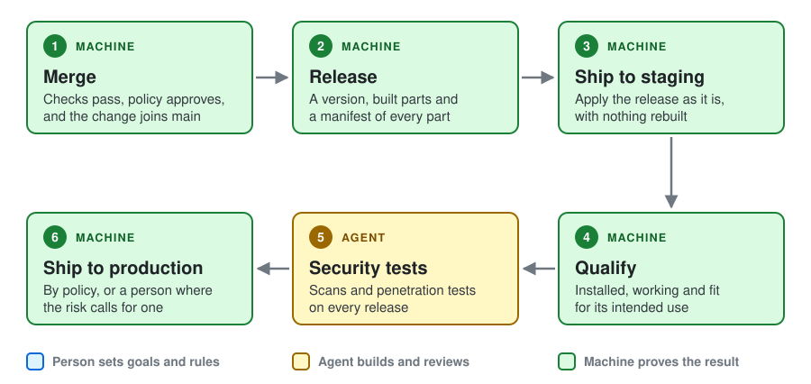

# Merge, Release and Ship

[ai-toolkit](../../README.md) / [Practices](../README.md) / [Engineering with Agents](README.md)

Merging a change, releasing a version and shipping it to users are three
different events. Keep them apart, let each one produce its own evidence, and
put the heavy testing where the software runs.

The term CI/CD joins three practices into one word, and teams then treat a
merge as if it were a shipment. That is why a merge so often waits for a
person. Once the three are separate, a merge can be automatic, because it
puts nothing in front of a user.

## Workflow

The steps in detail

1. **Merge.** The checks pass, the policy approves, and the change joins the
   main branch. This is continuous integration. Its only output is a verdict
   that the main branch is fit to release.
2. **Release.** The change gets a version, its parts are built once, and a
   manifest lists every part at its exact version. This is continuous
   delivery. The release is now in a shippable state, and nothing has been
   deployed.
3. **Ship to staging.** The release is applied to an environment that
   matches production. Nothing is rebuilt on the way. This is the first half
   of continuous deployment.
4. **Qualify.** Automated tests show that the release is installed as
   specified, works as specified, and is fit for the use it is intended for.
5. **Security tests.** Scans and penetration tests run against the deployed
   system, on every release. A source audit of the release commit runs
   beside them.
6. **Ship to production.** The same release, with its evidence attached, is
   applied to production. A policy decides this, or a person where the risk
   calls for one.

## The Practice

### Keep the Three Apart

| Event   | Also called            | Question it answers             | What it produces                        | What it never does        |
| ------- | ---------------------- | ------------------------------- | --------------------------------------- | ------------------------- |
| Merge   | Continuous integration | Is this change correct?         | A pass or a fail, and an updated branch | Assign a version, publish |
| Release | Continuous delivery    | Is there a version we can ship? | Versioned parts and a manifest          | Deploy anything           |
| Ship    | Continuous deployment  | Does it work where it runs?     | A running environment and its evidence  | Rebuild or repackage      |

Each event has one input, one output and one boundary. A failure in one does
not spread to the next. A failed merge produces no release, and a release
that fails in staging never reaches production.

### Let the Merge Be Automatic

A merge changes the main branch and nothing else. No user sees it, and
reverting it is one commit. So the gate for a merge is mechanical: checks
that nobody can skip, reviewer agents with their own instructions, and a
written policy that approves. See [Mechanical Checks](mechanical-checks.md)
and [Agent Code Review](code-review/README.md).

A person who approves every merge is guarding the wrong event. The cost of a
mistake arrives when the software ships, and that is where the evidence
should be.

### Make a Release a Shippable State

A release is a fixed thing that can be shipped at any time.

- **The version comes from the commits.** A commit message says whether the
  change is a fix, a feature or a breaking change, and a tool turns that
  into the next version number.
- **Each part is built once.** Packages and container images are published
  with that version and never changed afterwards. Until the release is
  qualified, they go to a registry that users cannot install from.
- **A manifest lists every part.** It names each package, image and
  infrastructure component at its exact version. It is the bill of
  materials for the whole release, and the record of what ran where.

Publishing where users can install is shipping. A package on a public
registry reaches its users at once, before any test in staging has run. A
tag that marks it as a pre-release does not change that, because anyone can
still install it. For
a library that has no environment of its own, the publish is the shipment,
so its qualification and security tests run before the publish.

Nothing downstream builds anything. The parts tested in staging are, byte
for byte, the parts that ship to production. Only the settings of each
environment differ.

### Test Where the Software Runs

Checks before a merge test the code. They cannot test the deployed system,
because there is none yet. Shipping to staging creates one, and three kinds
of test then run against it.

- **Qualification.** GAMP 5 is the guide the life sciences industry uses to
  validate computerised systems by risk. Validation under it is commonly
  organised in three parts. The system is installed as specified, it
  operates as specified, and it performs for its intended use. These are
  called installation, operational and performance qualification.
- **Intended use.** Tests walk through what a real user does with the
  system, from start to finish, and check the result the user needs.
- **Security.** Scans and penetration tests attack the running system the
  way an outsider would.

All of this runs automatically on every release. Its results are stored with
the release manifest, so the evidence for a version sits beside the list of
what the version holds.

What each kind of test shows

| Test                       | Shows                                                                 | Typical evidence                             |
| -------------------------- | --------------------------------------------------------------------- | -------------------------------------------- |
| Installation qualification | The right versions are deployed and configured                        | The manifest compared with what is running   |
| Operational qualification  | Each function works as its specification says                         | Scenario results against the deployed system |
| Performance qualification  | The system does its job under real conditions                         | End to end runs with realistic data and load |
| Intended use               | A user can reach the outcome the system exists for                    | Journeys recorded step by step, with results |
| Security scan              | The known weaknesses the scan found in dependencies, images or config | Scan reports for this exact version          |
| Source security audit      | The confirmed weaknesses the audit found in the code of this commit   | Findings and a ledger for this exact commit  |
| Penetration test           | Whether each attack that was tried got in                             | Each attempt, its result and what was fixed  |

The scenarios written for the specification are the source of the
operational tests. See [Goals and Specifications](goals-and-specs.md).

### Test Security on Every Release

Many organisations run a penetration test once a year. That interval was set
by cost. A test by a specialist team takes days and is priced to match, so it
is bought as rarely as a standard allows. Between two tests the system ships
dozens of times, and each of those versions is untested.

Automation and agents change the cost. A penetration test that an agent runs
against staging can run on every release, or every night. A weakness can then
be found in the version that introduced it, while the change is small and its
author remembers it.

A penetration test sees the system as an outsider does. A source audit
reads the code of the release commit, so it finds the missing check on a
path nobody thought to try. It needs no running system, so it starts as soon
as the release names a commit, and its verdict joins the other security
results at the production gate. See
[Source Security Audit](source-security-audit.md).

Keep the independent specialist test where a standard or a customer asks for
one. It no longer carries the whole load. It starts from a system that was
attacked yesterday, so the specialists spend their time on what automation
did not find.

### Decide Production by Risk

Shipping to production is the one step where a person may still be the right
gate. The table in [Agent Code Review](code-review/README.md) applies here as it
does to a merge. A policy ships where the
evidence is complete and the change is cheap to undo. A named person decides
where the change is hard to undo, or where a regulation says a person must
sign. That person signs with the evidence in front of them, which a reviewer
of a pull request never had.

## Why

Treating a merge as a shipment puts the slowest and weakest control, a
person reading a diff, in front of the event that matters least. It also
leaves the event that matters most with thin evidence, because the tests
that need a running system were never part of the gate.

Separating the three moves effort to where it buys assurance. The merge is
fast because it is safe to be wrong. The release is boring because it only
packages. The shipment is where the proof is made, against the thing users
will run.

The record is also better. A manifest and its test results answer what was
running on a given day and how it was shown to work. An approval on a pull
request answers neither.

## The Failure It Prevents

- A merge queue that waits days for a person who then approves unread.
- A release rebuilt for production, so that what shipped was never tested.
- A penetration test report that describes a system eleven months out of
  date.
- A regulated system whose validation evidence is assembled by hand after
  the fact.
- An incident where nobody can say which versions were running.

## How It Is Enforced

- The merge workflow publishes nothing, and the release workflow deploys
  nothing. Each has only the permissions its own step needs.
- Production accepts a release only when its manifest has qualification and
  security results attached, and the results are for that exact version.
- The tests run in an environment the author of the change cannot edit.

This repository uses the first part of this. Changes merge through required
checks. A release tool opens a pull request that proposes each next version
from the commit messages, some version numbers are still bumped by hand, and
a maintainer publishes the packages with a script. It has no environment to
ship to, so the staging steps do not apply here. The packages go to a public
registry, and for those the publish is the shipment.

[Software Delivery for a Changing System](https://www.lekman.com/blog/what-cicd-should-actually-do)
sets out the three practices in more depth, with the release manifest and
the split between packages and service images.
