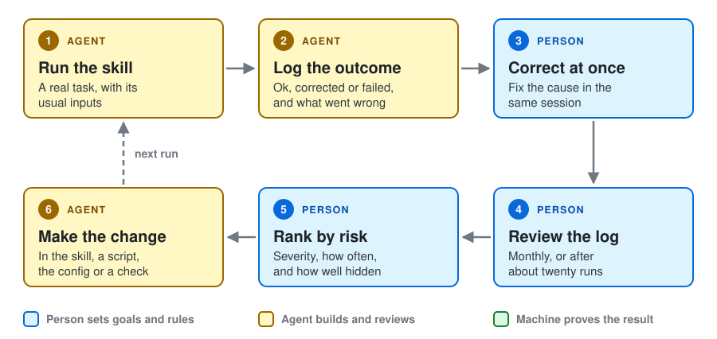

# Skill Feedback

[ai-toolkit](../../README.md) / [Practices](../README.md) / [Engineering with Agents](README.md)

A skill is a folder of instructions, and sometimes scripts, that teaches an
agent how to do one job your way. A skill is only as good as its last
correction. Correct it when it fails, log how each run went, and use the log
to decide what to change.

## Workflow



<details>
<summary>The steps in detail</summary>

1. **Run the skill.** The agent runs it on a real task.
2. **Log the outcome.** One entry records whether the run was ok, corrected
   or failed, and what went wrong.
3. **Correct at once.** When the output is wrong, a person fixes the cause in
   the same session. Steps 1 to 3 are the fast loop.
4. **Review the log.** A person reads the entries once a month, or after
   about twenty runs.
5. **Rank by risk.** Each kind of failure is scored for severity, for how
   often it happens and for how well hidden it is.
6. **Make the change.** The fix goes in the right place, which is the skill,
   a script, the configuration or a check. Steps 4 to 6 are the slow loop.

</details>

## The Practice

Two loops run at different speeds. The fast loop fixes what you saw today.
The slow loop finds what no single run shows.

### The Fast Loop: Correct at Once

When a skill's output is wrong, fix the cause in the same session, while the
evidence is in front of you. Correcting only the output means the next run
makes the same mistake.

Skills you run often gain most from this. An expenses import or a junk mail
sweep runs weekly or daily, so a correction made today is repaid within the
week.

### Decide Where the Correction Goes

A correction does not always belong in the skill. Sort it first.

| The correction is about                                | It goes in                                               | Example                                              |
| ------------------------------------------------------ | -------------------------------------------------------- | ---------------------------------------------------- |
| The method, true for anyone who uses the skill         | The skill's instructions                                 | "Check for a duplicate before creating an expense"   |
| A step that must be exact every time                   | A script inside the skill                                | Date arithmetic, a file rename, an API call          |
| Your own preferences or data                           | A configuration file outside the skill                   | Which senders are always junk, how you file receipts |
| Preferences you need on every machine and in the cloud | A shared store that every session can read               | The same guidelines, held in one place               |
| A rule the agent keeps breaking                        | A check, as in [Mechanical Checks](mechanical-checks.md) | A hook that refuses the write                        |

Keeping the method and the preferences apart has two benefits. The skill
stays shareable, because it holds nothing personal. And the preferences can
change daily without anyone editing or republishing the skill.

The junk mail skill in this toolkit works this way. Its instructions hold the
method. A personal rules file, named in a small configuration file, holds the
senders and patterns. At the end of a run the skill proposes additions to the
rules file and writes them only when you approve.

### Share Preferences Across Machines

A local configuration file serves one machine. When the same skill runs on a
laptop, a second machine and a cloud session, the preferences need one home
that all three can reach. There are three options, listed by setup cost.

1. **A note in a synced notes vault.** This works on every machine that syncs
   the vault and not in a cloud session.
2. **A private artifact.** A published page that the agent can read and
   update by its address, from any session signed in to the account.
3. **An artifact with a database.** The page keeps structured records that the
   agent reads and writes one row at a time, which suits rules and logs
   better than a document does.

The second and third options are the ones a cloud session can use. I have not
yet run a skill against an artifact database from a cloud session, so treat
that part as a design to test.

### The Slow Loop: Log Every Outcome

Record one entry each time a skill runs. The entry takes seconds, and nothing
else on this page works without it.

| Field      | Holds                                                       |
| ---------- | ----------------------------------------------------------- |
| `date`     | When the run finished                                       |
| `skill`    | The skill's name and version                                |
| `outcome`  | `ok`, `corrected` (you fixed the output) or `failed`        |
| `mode`     | A short name for the way it went wrong, empty when `ok`     |
| `what`     | One sentence on what went wrong, empty when `ok`            |
| `cause`    | Your best guess at why, and whether it is confirmed         |
| `detected` | How the problem was found: `check`, `review` or `later-use` |
| `fix`      | Where the correction went, using the table above            |
| `cost`     | Time or tokens, when you have the number                    |

```json
{
  "date": "2026-11-28",
  "skill": "expenses@1.4.0",
  "outcome": "corrected",
  "mode": "creates-duplicate",
  "what": "Created a second expense for a receipt already imported",
  "cause": "Duplicate check compares amount only (confirmed)",
  "detected": "review",
  "fix": "skill-script",
  "cost": "6 min"
}
```

Entries that share a `mode` are one failure mode, so the analysis can count
them. Reuse a name the skill already has before making a new one.

Log the runs that went well too. Without them you cannot tell a skill that
fails one run in fifty from one that fails every second run.

Store the log outside the repository, in the same place as the preferences,
so one analysis can read every machine's entries.

### Analyse the Log with FMEA

Failure mode and effects analysis (FMEA) is a method from manufacturing and
medical device engineering for deciding which failures to fix first. Run it
on the log once a month, or when a skill has around twenty entries.

1. **Group the entries by failure mode.** A failure mode is one way the skill
   goes wrong, such as "creates a duplicate" or "deletes a wanted message".
2. **Score each mode from 1 to 10 on three scales.**
   - Severity is how bad the effect is when it happens.
   - Occurrence is how often it happens, taken from the log's counts.
   - Detection is how likely it is to go unnoticed, where 10 means nobody
     would notice.
3. **Multiply the three scores.** The result is the risk priority number.
4. **Start with the highest numbers.** Also look at any mode with a severity
   of 9 or 10, whatever its total.
5. **Choose the change.** Lower occurrence with a script or a clearer
   instruction. Lower the detection score with a check that catches the
   failure. If neither is possible, add a confirmation step or retire the
   skill.
6. **Record the decision and score again after the change has run for a
   while.**

A failure that is rare, mild and always caught may need no action. The
analysis is useful because it lets you say so with a reason.

## Why

Without a log, the skill you change is the one that annoyed you most
recently. That is the last failure you remember, and it may be neither the
most frequent nor the most harmful. The log replaces memory with counts, and
the analysis replaces irritation with a ranking.

Sorting corrections also keeps a skill short. A skill that absorbs every
preference grows until the agent follows less of it, which is the same
problem as an instruction file that only grows.

## The Failure It Prevents

- Fixing the same output by hand every week.
- A skill that grows a paragraph per incident and becomes unreliable.
- Personal rules that differ between machines, so the same skill behaves
  differently depending on where it runs.
- A serious but quiet failure that is never fixed, because a harmless and
  visible one takes the attention.

## How It Is Enforced

Four parts exist in this toolkit today.

- The junk mail skill keeps its method and its personal rules apart, and
  proposes rule additions for approval.
- The [Wrap](../../plugins/wrap/README.md) plugin reviews a session for
  corrections and recommends where each belongs.
- The [Skill Feedback](../../plugins/skill-feedback/README.md) plugin writes
  the outcome log. Its `log` skill validates one entry and appends it to a
  local file, then pushes it to a private artifact database from sessions
  that can reach it. The junk mail skill calls it as its last step.
- The same plugin's `review` skill runs the analysis. A script groups the
  entries by skill and mode, takes occurrence and detection from the log,
  multiplies them with the severity you set for each mode, and ranks the
  result. The skill proposes one change per mode and applies none.

Three limits remain.

- Only the junk mail skill logs its runs so far. Every other skill needs the
  closing step added.
- A skill logs because its instructions say so. No hook checks that a run
  ended with an entry, so an interrupted run logs nothing.
- The shared copy belongs to one account. It worked from a desktop session
  signed in as the owner. A command-line session signed in to another account
  on the same machine was refused, and a cloud session has not been tested.
  Those runs log to the local file only.
