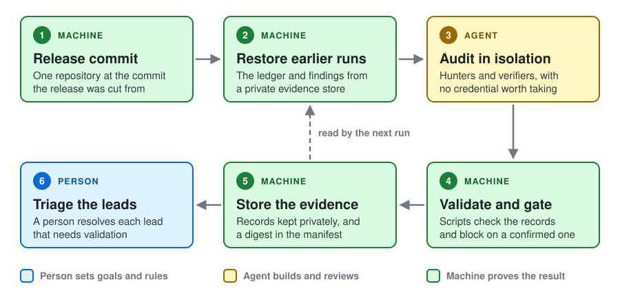

# Source Security Audit

[ai-toolkit](../../README.md) / [Practices](../README.md) / [Engineering with Agents](README.md)

A source security audit has agents read one repository at one commit and
report where a trust boundary fails. Run it on the commit a release was cut
from, keep its records with the release, and let a confirmed finding block
the shipment to production.

This page is a design, written on 28 Nov 2026. It describes how the
`security-audit` skill published by Cloudflare would run in the workflow from
[Merge, Release and Ship](merge-release-ship.md). The skill was read and
tested at one commit, and
[Vetting Record for the Security Audit Skill](security-audit-skill-vetting.md)
holds that evidence. No pipeline runs the audit yet, and the decision to adopt
the skill is open.

## Workflow

The steps in detail

1. **Release commit.** The release names one commit. The audit reads the
   repository at that commit and nothing else.
2. **Restore earlier runs.** The job copies the records of every earlier run
   for this repository from a private store. The audit reads them to find
   what is still uncovered.
3. **Audit in isolation.** Agents map the code, hunt for failures and try to
   disprove each candidate. They run in a container that holds no credential
   worth taking.
4. **Validate and gate.** Scripts check the form of the records, then check
   that the run finished, that it read the release commit, and that no
   confirmed finding at the chosen severity is open.
5. **Store the evidence.** The whole run folder goes to the private store.
   The release manifest records the run, the verdict and a digest.
6. **Triage the leads.** A person takes each lead the audit could not settle
   from source, and records the answer.

The dashed arrow shows that the records stored in step 5 are input to step 2
of the next run.

## The Practice

### Know What the Audit Covers

The skill reads source. It maps who can call what, follows untrusted input
to the place where it does harm, and reports each path as a record with a
file and a line.

| It covers                                                               | It does not cover                                          |
| ----------------------------------------------------------------------- | ---------------------------------------------------------- |
| One repository at one commit                                            | A deployed system, in any environment                      |
| Injection, access control, file handling, cryptography, business logic  | Settings that live outside the repository, such as a proxy |
| Ten further areas, such as cloud configuration, chosen by what it finds | A lookup of known weaknesses in dependencies               |
| Running the target's own tests, only inside a sandbox with no network   | Any request to a live service, account or endpoint         |
| Coverage that grows when it is run again                                | Proof that nothing is wrong                                |

The skill's own rules forbid probing a deployed endpoint, so it cannot be
the penetration test in step 5 of the delivery workflow. Its description
lists "pen tests" among the requests that start it. What then runs is a
source audit.

Every record has one of three verdicts.

| Verdict            | Meaning                                                          | Severity | Who acts                |
| ------------------ | ---------------------------------------------------------------- | -------- | ----------------------- |
| `confirmed`        | The path is traced in source and its result was observed locally | Yes      | The gate, then the team |
| `needs_validation` | The path is real, and one fact outside the source decides it     | No       | A named person          |
| `rejected`         | A second agent disproved the candidate                           | No       | Nobody                  |

A clean result is weak evidence. The skill's authors report that one run
found about half of what repeated runs found in total, and the skill tells
its agents never to claim that one run exhausts the target.

### Run It on the Release Commit

The audit needs the source and nothing else. It needs no built part and no
running environment, so it can start as soon as the release names a commit.

- **Start it from the release.** The audit runs beside the shipment to
  staging and the qualification tests. It does not wait for them, and they
  do not wait for it.
- **Check it at the production gate.** Production accepts a release only
  with its evidence attached. The audit's verdict for that exact commit is
  one more piece of that evidence.
- **Check it before the publish, for a library.** A package on a public
  registry reaches its users at once, so the publish is the shipment. The
  audit's verdict is checked before it.
- **Keep the penetration test.** Step 5 still needs a tool that attacks the
  deployed system. The source audit reads the inside of the code, and the
  penetration test tries the outside of the running system. Each finds what
  the other cannot reach.
- **Run it between releases as well.** A nightly run on the main branch adds
  coverage. The run at release then starts from that coverage.

The audit does not belong in the merge gate. One run makes many agent calls,
and two runs on the same commit can report different things. A merge check
must give the same answer to everyone, every time. See
[Mechanical Checks](mechanical-checks.md).

### Run It in Isolation

The repository under audit is input to the agents. A file in it, or in a
dependency, can hold text written to mislead them. Run the audit where a
misled agent can reach nothing of value.

- **One credential.** The job holds the key for the model and no other
  secret. It has no deployment key and no token that can write to a
  repository.
- **A copy of the source that cannot be changed.** The audit describes
  fixes. It never edits the target.
- **Output outside the target.** The skill writes its run folder outside the
  repository by default, so the records cannot be committed by accident.
- **A sandbox for the target's code.** The skill runs the target's builds
  and tests only inside a sandbox that the operating system enforces.

See [Isolated Container](../isolated-container/README.md).

The sandbox decides how useful the audit is as a gate. The skill asks for
five controls, which are no outside network, an empty environment, a target
that cannot be changed, writes to one scratch folder, and limits on
processor time and memory. When any is missing, its rules say to run nothing
and to record the candidate as `needs_validation`. A runner without the
sandbox would therefore produce leads for a person and few confirmed
findings. This follows from the skill's text and has not yet been observed
in a run. The skill ships no sandbox, so whoever adopts it builds one.

### Keep the Evidence With the Release

A run writes one folder.

| File                    | What it holds                                                       |
| ----------------------- | ------------------------------------------------------------------- |
| `run-metadata.json`     | The commit, the scope, the run profile and whether the run finished |
| `architecture.md`       | A summary of the system and its trust boundaries                    |
| `coverage-ledger.json`  | Every unit of work, and whether it was covered, blocked or deferred |
| `findings.json`         | Every record, under one of the three verdicts                       |
| `REPORT.md`             | The findings and the coverage, for a reader                         |
| `FINDINGS-DETAIL.md`    | Each confirmed finding of medium severity or above, with its steps  |
| `NEEDS-VALIDATION.md`   | Each open lead, with the fact that would settle it                  |
| `agents/<id>/artifacts` | Output kept from a local check                                      |

Store the whole folder in a private place, under the repository's name and
the run's number. The release manifest then records four things.

1. The number of the run.
2. The commit the run read.
3. The verdict of the gate.
4. A digest of the stored folder, so a later reader can show it is unchanged.

Do not attach the folder to a public release. A confirmed finding holds the
steps to reproduce a weakness that may not be fixed yet.

### Keep the Ledger Between Runs

The coverage ledger is a list of units. Each unit is one entry point, one
trust boundary, one part of the system and one kind of attack. The skill
reads the ledgers and findings of earlier runs before it plans a new one, so
a later run spends its effort on what is still open.

The skill writes each run to a numbered folder, under one folder for the
repository, and records in the new run which earlier folders it read. A
runner in continuous integration (CI) starts empty, so the job moves the
folders itself.

1. Before the run, copy every earlier run folder for this repository from
   the store.
2. Let the skill write the next numbered folder.
3. After the gate, copy the new folder to the store.
4. Never change a stored folder. Each run is a record of its own commit.

The ledger from an older commit is still valid input. The skill compares
each earlier unit with the current source and does not trust the earlier
commit to tell it what changed.

What the skill does with an earlier record

| Earlier state                            | In the new run                                             |
| ---------------------------------------- | ---------------------------------------------------------- |
| `confirmed`, and the source is unchanged | Carried forward, checked again, and kept out of the hunt   |
| `confirmed`, and the source changed      | Planned again as new work                                  |
| `needs_validation`                       | Planned again, and it keeps its open question              |
| Deferred, blocked or out of scope        | Planned again as new work                                  |
| Covered, and the source is unchanged     | Kept visible, with lower priority                          |
| `rejected`                               | Only the same claim is skipped, and the unit is still read |
| A short or partial run                   | Counts for what it recorded, and for nothing beyond that   |

These are the skill's written rules at the vetted commit. They have not been
observed over two runs.

### Gate on the Records

The skill has two validator scripts, one for the ledger and one for the
findings. They check form. Both accept an empty file, a ledger where no
unit was ever worked on, and a ledger that names a candidate the findings
file does not hold. A critical finding also passes, because the validators
do not judge content. The vetting record shows each of these.

The gate is therefore a script of its own that runs after the validators. A
release is blocked when any of these is true.

| Check                                                          | Why it blocks                              |
| -------------------------------------------------------------- | ------------------------------------------ |
| A validator fails                                              | The records cannot be trusted or compared  |
| `run-metadata.json` does not say the run is complete           | The audit stopped early                    |
| The commit in `run-metadata.json` is not the release commit    | The evidence is for a different version    |
| The ledger is empty, or a unit is still planned or in progress | Work was skipped without a recorded reason |
| A candidate in the ledger has no record in the findings        | A lead was dropped before it was judged    |
| A `confirmed` finding is at or above the chosen severity       | A known weakness would ship                |

Choose the severity once, in policy. A reasonable start is to block on
`high` and `critical`, and to open a ticket for anything lower.

The rest goes to a person and does not block.

- **Every `needs_validation` record.** It has no severity by design. It
  names the fact that would settle it, such as a proxy rule, and a safe way
  to observe that fact. A named person observes it and records the answer.
- **Units that were deferred, blocked or out of scope.** The manifest
  states how many, so a partial audit is visible as partial.
- **Confirmed findings below the chosen severity.** These become ordinary
  work with a due date.

An exemption is the only way past a blocking finding. It is a named entry in
one file, with the finding's fingerprint, a reason, a person and an end
date, and it is reviewed like code. The same file holds the answers to
leads, because the skill has no field for a person's answer and a lead
returns on every run until the source changes.

A pass means that no known blocker is open. It does not mean the release is
secure.

Each failure follows the rule in [Mechanical Checks](mechanical-checks.md).
It names the finding, the file and line where the path ends, the change the
audit proposes, and the page that explains the gate.

## Why

Security tests against a running system see it as an outsider does. They
cannot see a missing check on a path nobody thought to try. A source audit
starts from the code, so it finds the missing check and points at the line.
The two together cover more than either alone.

The argument for running it on every release is the one for penetration
tests. A yearly review describes a system that has since shipped dozens of
times. An audit on the release commit finds a weakness in the version that
introduced it.

The verdicts suit a gate because they separate what is known from what is
suspected. A confirmed finding was traced by one agent, checked by a second
that tried to disprove it, and observed in a local run. That is strong
enough to block on. A lead with an open question is a job for a person, and
giving it a severity would only hide that.

The records are still claims made by agents. The validators prove their
form, and no script proves that a unit marked as covered was read with care.
So the gate blocks on what the audit found, and nobody reads a clean result
as proof.

## The Failure It Prevents

- A security review once a year, whose report describes an old version.
- Findings that live in a chat or a document, where they cannot be tracked
  from one release to the next.
- An audit that reads the same code on every run and forgets the leads it
  could not settle.
- An audit agent that holds deployment credentials while it reads untrusted
  text.
- Reproduction steps for an open weakness, published with the release notes.
- A release that ships because the audit job failed quietly and left empty
  files that still pass validation.

## How It Is Enforced

Nothing on this page is enforced yet. When it is built, these are the
controls.

- The skill is installed from a reviewed copy at a recorded commit. See
  [Third-Party Skills](third-party-skills.md).
- The audit job runs in a container with one credential, and its workflow
  has no permission to write to a repository or to deploy.
- The gate script has tests of its own, with a failing case and a passing
  case for each row of the table above.
- Production accepts a release only when the manifest holds a passing audit
  verdict for that exact commit.
- The evidence store is private, and stored runs are never changed.

This repository publishes packages to a public registry, and for those the
publish is the shipment. An audit of the release commit would therefore have
to pass before the publish. Nothing has been decided about running one here.
