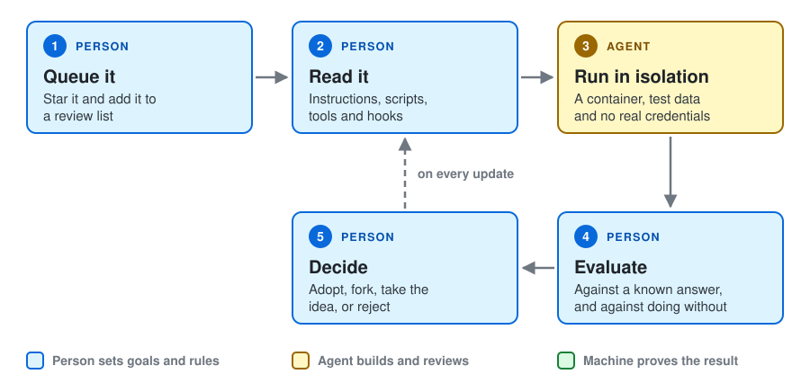

# Third-Party Skills

[ai-toolkit](../../README.md) / [Practices](../README.md) / [Engineering with Agents](README.md)

A skill written by someone else is untrusted code and untrusted instructions.
Queue it, read it, run it in isolation and evaluate the result before it is
installed where it can reach your work.

## Workflow

The steps in detail

1. **Queue it.** Star the repository and add it to a review list. Do not
   install it at the moment you find it.
2. **Read it.** Read the instructions, the scripts, the tools it asks for
   and any hooks or servers it adds.
3. **Run in isolation.** Run it in a container with test data and no real
   credentials.
4. **Evaluate.** Compare its output with an answer you already know, and
   with the agent doing the same task without the skill.
5. **Decide.** Adopt it, fork and trim it, take the idea, or reject it. Read
   it again before taking an update.

## The Practice

A skill is a folder of instructions and, often, scripts. Once installed, the
instructions steer your agent and the scripts run with your agent's access.
That is the access of whatever machine and account the agent runs under.

### Queue It

Do not install a skill at the moment you find it. Star the repository and add
it to a review list. The delay costs nothing, and it separates the decision
from the enthusiasm of finding something useful.

### Read It

Read the whole folder before running any of it.

- **The instructions.** Look for steps unrelated to the stated purpose, such
  as reading credentials, changing settings or contacting an address.
- **The scripts.** Read them as you would a pull request from a stranger.
- **The tools it asks for.** A skill that formats text has no need for shell
  or network access.
- **Hooks and servers it adds.** These run outside the skill's own steps and
  keep running after it finishes.
- **What it downloads.** A script that fetches and runs remote code can
  change after your review.

Asking an agent to analyse the skill is a useful first pass. Run that
analysis in a session with no access to anything you care about, because the
skill's text is itself input to the agent and may be written to mislead it.

### Run It in Isolation

Run the skill first where a bad outcome is cheap.

- A container that holds one throwaway repository and no real credentials.
  See [Isolated Container](../isolated-container/README.md).
- Test data, never a real mailbox, ledger or customer file.
- A model on your own machine when the test input is sensitive. See
  [Local Models](../local-models/README.md).

### Evaluate the Outcome

Give the skill a task whose correct answer you already know.

1. Compare its output with the known answer.
2. Compare it with the agent doing the same task without the skill. A skill
   that adds nothing is extra context on every turn for no gain.
3. Check what it touched. List the files changed, the commands run and the
   network calls made, and confirm each belongs to the task.

### Decide

| Decision      | When                                           | What to do                                        |
| ------------- | ---------------------------------------------- | ------------------------------------------------- |
| Adopt         | It is correct, minimal and does only its job   | Install the version you reviewed and record which |
| Fork and trim | The method is good and parts are unwanted      | Copy it, remove what you do not need, maintain it |
| Take the idea | The approach is useful and the code is not     | Write your own skill from what you learned        |
| Reject        | It asks for more access than its purpose needs | Remove it from the list with a one-line reason    |

Review again before taking an update. The version you approved is the only
one you have evidence for.

The [Source Audit](../../plugins/source-audit/README.md) plugin is one result
of these steps. A security audit skill by another publisher was read in full
and run in isolation, and the decision was to take the idea. The plugin's
page records the commit that was read, what the run measured, what was taken
and what was left out.

## Why

A skill reaches further than a library. A library runs when your code calls
it. A skill's instructions are read by an agent that can open files, run
commands and call services, and the agent treats those instructions as
guidance from you.

Popularity is weak evidence. A star count shows that people found the
repository, and it does not show that anyone read the scripts.

## The Failure It Prevents

- A skill that quietly reads credentials or sends data elsewhere.
- A skill that changes after installation because it downloads its own
  logic.
- A growing set of installed skills that each add context to every turn and
  that nobody has compared with doing without them.

## How It Is Enforced

- New skills are tried only inside the isolated container, which holds no
  credential worth taking.
- Installed skills are pinned to the reviewed version where the installer
  allows it. Where it does not, keep a reviewed copy in your own repository
  and install from that.
- Once adopted, the skill's runs go in the same outcome log as your own. See
  [Skill Feedback](skill-feedback.md).
