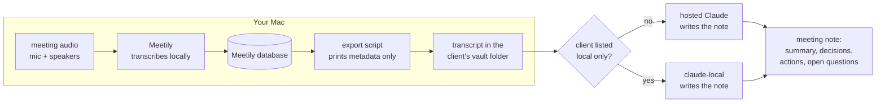

# Meetings

Notes from a meeting the meeting tool cannot or should not record. This
practice covers two common cases:

- You join another organisation's Teams or Google Meet as a guest, and
  recording is turned off for you.
- The tool could record, but the recording would then sit on a server you do
  not control, next to a transcript you cannot delete.

The answer is to record and transcribe on your own machine, then let an agent
turn the transcript into a note. The meeting tool needs no bot, no setting and
no permission from its owner, so the decision to take notes stays with the
people in the meeting.

## Tell the People in the Meeting

A local transcript is still a record of what people said. Recording is often
turned off on purpose, and a local transcript works around that setting
without anyone being told. Contracts with clients can also cover any record of
a meeting, whatever tool makes it.

Say at the start of the meeting that you take notes with local transcription.
That puts the record in the open, where a recording bot would have been.

## How It Works

1. **Capture.** [Meetily](https://github.com/Zackriya-Solutions/meetily) (MIT
   licence) records your microphone and the system audio through a Core Audio
   tap (macOS 14.2 or later). It works with any meeting tool, and headphones
   work as they are, AirPods included. A virtual audio driver such as BlackHole
   is not needed.
2. **Transcribe.** Meetily transcribes on the Mac. Parakeet is fast and
   accurate for English. Whisper large-v3-turbo handles Swedish and other
   languages.
3. **Export.** The [meeting plugin](../../plugins/meeting/README.md) copies one
   meeting's transcript into the client's vault folder. The script prints only
   metadata, so the transcript text does not reach the agent at this step.
4. **Write the note.** The agent reads the transcript and writes summary,
   decisions, actions and open questions, each with the transcript time it came
   from.

## Who Reads the Transcript

The export and the note are separate steps, because they have different
privacy costs. Exporting keeps everything on the Mac. Writing the note sends
the transcript to whichever model the session runs on.

Each client gets one setting. By default the hosted model writes the note. A
client listed as local only gets its transcript exported by any session, but
read only by a session on a local model
([local models](../local-models/README.md)). The hosted session stops before it
reads the file.

This is the same split as in [Privacy](../../privacy/README.md): decide on
purpose what the model is allowed to see, and make the default the one you can
defend.

## What Is Left on Disk

Count every copy, not only the note:

| Copy                  | Where                                                    | Removed when you delete the meeting in Meetily |
| --------------------- | -------------------------------------------------------- | ---------------------------------------------- |
| Audio                 | `~/Movies/meetily-recordings/<meeting>/audio.mp4`        | No                                             |
| Transcript (JSON)     | `~/Movies/meetily-recordings/<meeting>/transcripts.json` | No                                             |
| Transcript (database) | Meetily's database in Application Support                | Yes                                            |
| Transcript (markdown) | The client's vault folder                                | No, it is yours to keep                        |
| Note                  | The client's vault folder                                | No, it is yours to keep                        |

Turn off audio saving in Meetily's Recordings settings if text is enough, and
delete the meeting folder under `~/Movies/meetily-recordings` once the note is
written. Keeping the audio lets you transcribe a meeting again with another
model if the first transcript is poor.

## Approaches Not Taken

- **A Python script on top of BlackHole.** Small open-source projects do this.
  They capture only the speakers, so your own voice is missing. They also need
  audio routing that silences headphones unless you build a multi-output
  device.
- **Building capture in this repository.** A Core Audio tap needs a Swift or
  Rust helper, and the open-source helper checked (AudioTee) has no licence
  file, so it cannot be bundled in a public repository. Meetily
  already solves capture and transcription, so this repository only adds the
  part that is specific to how the notes are used.
- **Meetily's own summary.** It can summarise with a local or a hosted model,
  but the result lives in Meetily, not in the vault. The vault note is what planning, search
  and later sessions read.

## Known Limits

Meetily 0.4.1 transcribes the microphone and the system audio into one stream
without saying which source a line came from. The note says who spoke only
where the transcript names the speaker. Segments are long (a one-minute test
produced two), so a time stamped on an action points to its segment rather than the exact
sentence.
