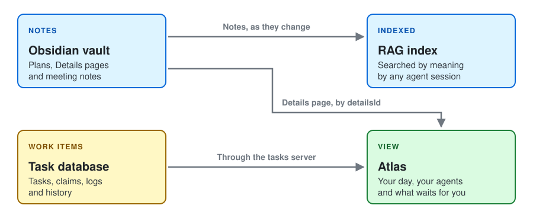

# Obsidian as an Agent-Operated Workspace

[ai-toolkit](../../README.md) / [Practices](../README.md)

How to run an Obsidian vault where an AI agent (Claude Code) does most of the
writing, filing and tidying. Written so a colleague can copy the practice
rather than guess at it. The reader is a consultant or engineer who keeps
notes for more than one client and wants an agent to maintain them.

Obsidian holds the notes, and the agent works inside them. The work items do
not live in the vault. They live in a task database, and
[lekman/atlas](https://github.com/lekman/atlas) shows them beside the notes
they link to. The vault's value comes from written conventions, so the agent
produces the same shape of note every time.

Until late October 2026 the vault also held the day's work list, in a
Markdown file named `Dashboard.md`. That file is retired.
[Why the Work List Left the Vault](#why-the-work-list-left-the-vault) gives
the reason.

## The Stack at a Glance

| Layer               | What it is                                     | What it does                                                             |
| ------------------- | ---------------------------------------------- | ------------------------------------------------------------------------ |
| Obsidian            | Local markdown editor over a folder of `.md`   | The notes themselves; nothing is locked in a proprietary format          |
| Community plugins   | A small, earned set                            | Dataview queries, image conversion, deep links, a terminal               |
| Task database       | Postgres behind a tasks server, from this repo | Every client's work items, with claims, a log and a history              |
| Atlas               | A web page served from a computer you own      | Your day, your agents and what waits for you, with each task's notes     |
| Claude Code         | Anthropic's agent CLI                          | The actual agent; reads `CLAUDE.md`, rules and skills                    |
| Rules and skills    | Markdown files in `.claude/`                   | The house style and the repeatable jobs                                  |
| Plugin marketplaces | GitHub repositories                            | Shared skills across machines and clients (this repo is one)             |
| ObsidiBot           | Obsidian plugin by Scott Kirvan, optional      | Chat panel that runs Claude Code as a subprocess with the vault as `cwd` |

## Where Each Thing Lives



| Thing      | Kept in        | What it holds                                | How it reaches Atlas                                                       |
| ---------- | -------------- | -------------------------------------------- | -------------------------------------------------------------------------- |
| Notes      | Obsidian vault | Meeting notes, plans and Details pages       | A Details page is found by the `detailsId` of its task                     |
| Work items | Task database  | Tasks, claims, logs and history              | Through the tasks server, which checks every write and records who made it |
| The view   | Atlas          | Your day, your agents and what waits for you | It reads both and is the master copy of neither                            |

Shared tickets stay in the client's own tracker (Jira, GitHub or Monday). A
task keeps a link to its ticket and does not copy it.

## Obsidian Setup

Vault settings worth copying, all from `.obsidian/app.json`:

- **New notes land in `_Drafts/`.** Nothing is filed at creation time. Filing
  happens later, by hand or by the agent, once the note has a subject.
- **Attachments go to `_Attachments/`** and unlinked attachments are deleted
  automatically.
- **Links update on move** (`alwaysUpdateLinks`), which is what makes bulk
  renaming safe.
- **`_Attachments`, `CLAUDE.md` and `Archive` are hidden from search** and the
  quick switcher. They stay on disk and the agent still reads them. They no
  longer crowd the results.
- **Inline title is off**, because the H1 in the body is the title.

Plugins that have earned a place here are Dataview for the client landing
pages, Advanced URI for deep links from outside the vault, an image converter
that turns pasted screenshots into `.webp`, copy-as-html for pasting into
email or Teams, a converter from markdown to tracker markup, Mermaid helpers
with a CSS snippet that widens diagrams, a terminal, and BRAT to install
plugins from GitHub. Add plugins only when a real need appears. Several more
were tried here and switched off.

## Vault Conventions

The conventions are the part that matters, because they are what the agent is
instructed to follow.

**Folders.** One folder per client under `Clients/`, each with `Meetings/`,
`Initiatives/`, `Reports/`, `_Attachments/` and a landing page named after the
client. Business admin sits under `Management/`, private material under
`Personal/`, finished engagements under `Archive/`.

**Frontmatter is required on every note.** The schema lives in a rule file the
agent always loads:

```yaml
---
type: meeting | note | document | reference | template
client: ClientA | ClientB | YourCompany | Personal | Templates
status: draft | active | archived
stage: planned | post-meeting | complete # meetings only
tags: []
created: YYYY-MM-DD
---
```

`created` is set once and never touched again. `status` starts at `draft` and
moves to `active` when the note is in real use.

**Naming.** Descriptive, never a bare date. Meeting notes are
`YYYY-MM-DD Topic.md`. Reports carry the date in the title, for example
`Weekly status call, meeting notes, 14 August 2026`.

**Links.** `[[wikilinks]]` internally, standard markdown for external links.

**Details pages.** Each piece of work has one Markdown page under the
client's `Initiatives/` folder. It says what was done, why, and the evidence,
such as pull requests, commits, files and results. One sentence is enough
when there is little to say. The file name in lower case with hyphens is the
task's `detailsId`, and that is the only link between the task and the page.
Atlas finds the page by file name alone, so give every Details page a name
that is unique in the vault. It does not look in folders whose names start
with `_` or `.`, so a page left in `_Drafts/` is not found.

**Writing style.** One rule file holds the house style (plain language, banned
filler words). The agent applies it to everything it generates, including
commit messages.

## Tasks and Atlas

The work list is a database, and the vault holds the explanation of each item
on it.

**The task database** holds every client's work items. The schema is in
[dashboard-schema](../../packages/dashboard-schema/README.md) and the server
in [tasks-mcp](../../packages/tasks-mcp/README.md), both in this repository.
An agent reaches it through the [tasks](../../plugins/tasks/README.md)
plugin, and the rules it keeps are the reason it replaced a file:

- **Every write names the session that made it** and lands in the item's
  history.
- **A claim is exclusive.** An agent claims a task before it starts, and a
  second agent's claim is refused.
- **A write is checked against the revision it read**, and refused when
  someone else wrote first.
- **The order is computed** from business value, effort and the due date,
  so an agent does not choose what matters most.

**Atlas** is the view. It is a personal console, built in
[lekman/atlas](https://github.com/lekman/atlas), a public repository. It runs
on a computer you own and is reachable only over your own Tailscale network.
Its Missions section shows today, tomorrow and the backlog for each client,
and its Beam section shows the approvals and questions your agents wait on.
The repository's README lists the other sections.

Atlas uses the vault in three ways:

- **It reads a task's Details page** from the vault, by the task's
  `detailsId`, and shows it with the task.
- **Its local server keeps its configuration in a folder in the vault**,
  named `_Dashboard Sync/` in the examples. The server takes the folder above
  it as the vault.
- **A copy of the built page is kept in that folder**, where the VS Code
  extension, [Atlas](../../packages/vscode-planner/README.md), reads it.

Atlas's own server only reads the task database. A change you make in Atlas,
such as a new status, value or day, goes through the same tasks server the
agents use, so it is checked and recorded the same way.

**Hooks join the work to the notes.** The tasks plugin refuses `git commit`
and `git push` until the session has claimed or added a task. It refuses
`gh pr create`, and completing a task, until that task has a Details page.
Every pull request can then be traced to a task, and every finished task to
a page that explains it.

**Pull requests move the task.** The agent links its pull request to the
task and sets the state to `review`.
[gh-events](../../packages/gh-events/README.md) then moves the task to
`approved`, `merged` and `done` as the pull request is approved, merged and
released.

**Reports come from the same records.** `tasks report` answers "what was done
last week for this client" from the task logs, the state changes, the pull
requests and the Details pages. Nothing is written a second time for the
stand-up or the client call.

### Why the Work List Left the Vault

`Dashboard.md` was plain Markdown, grouped by day and by client, and
maintained by hand and by agents. Several skills and scripts wrote the same
file. Each one read the file, changed it in memory and wrote the whole file
back, so the last writer won and the others were not told. A guard script
and a snapshot before each write caught some cases. The cause stayed, because
the file was shared state with no lock. The task database removes the cause
with claims, revision checks and a history.

Notes are different. A meeting note or a Details page rarely has two writers
at once, so Markdown in a vault still fits them.

## ObsidiBot

ObsidiBot is optional. It puts a chat panel in the Obsidian sidebar. Behind
it, Claude Code runs as a subprocess with the vault root as its working
directory. It is the same agent used in a terminal, given the vault instead
of a code repository. Its documentation is at
[ObsidiBot](https://www.scottkirvan.com/ObsidiBot/).

An agent does not need it to work in the vault. A Claude Code session started
in a code repository writes plans and Details pages into the vault by path.
ObsidiBot suits work that starts from a note:

- It reads and writes vault files directly, so "file this draft under the
  client and add the frontmatter" is one sentence rather than a
  copy and paste loop.
- The active note is passed in automatically, and so are files open in a split
  pane. There is rarely any need to say which note is meant.
- It can drive the Obsidian interface. It can open a file, open it beside the
  current one, jump to a heading and run a command from the palette.
- It picks up `CLAUDE.md`, the rules and the skills, so house style is applied
  without being restated.

Two settings deserve comment:

- **Permission mode.** Full access is set here deliberately, because the
  workflow depends on shell tools (`pandoc`, `python3`, `gh`). It also means
  the agent can delete files, and the only safety net in a vault without git
  is the sync service's version history. Start in a mode that asks first and
  move up once you can predict what the agent will do.
- **The context file.** A single markdown file describing the vault, the
  conventions and the active clients, injected at the start of every session.
  The agent updates it when it learns something durable. Without it, every
  session starts by rediscovering the same facts.

### Skills, Where Most of the Gain Sits

A skill is a folder under `.claude/skills/<name>/` with a `SKILL.md` inside. The
file holds a name, a description of when to use it, and prose instructions.
It then works as `/name` in any Claude Code session in the vault. The skills
kept in the vault here, generalised:

| Skill shape         | What it does                                                                           |
| ------------------- | -------------------------------------------------------------------------------------- |
| Report builder      | Produces a formal `.docx` deliverable following the client's document conventions      |
| Weekly meeting note | Builds the recurring client meeting note, starting from the last one                   |
| Stand-up note       | Builds the daily stand-up, tracking which promises from yesterday held                 |
| Graph connector     | Adds a `## Related` section across notes so graph view shows real connections          |
| Landing page        | Creates or refreshes a client overview page                                            |
| Batch rename        | Proposes shorter filenames across a folder, then renames and fixes every wikilink      |
| Evidence scan       | Runs an authorised scan against a client's own endpoints and writes an evidence report |

Whenever a piece of writing has been done the same way three times, it
becomes a skill. The instructions are prose and hold no code.

## The Claude Code Layer Underneath

This layer explains behaviour that is otherwise hard to account for.

**Instruction files chain.** `~/.claude/CLAUDE.md` points at this repository's
[standards](../../standards/CLAUDE.md), which split the house rules into small files
on how to work together, tone, bias, evidence, judgment and proportion. The
vault's own `CLAUDE.md` adds the part that is specific to the vault.

**Rules directory.** `.claude/rules/` in the vault holds the files that are
always loaded. They are the frontmatter schema, the response style, the word
blocklist and the bias checklist.

**Shared skills come from GitHub marketplaces.** This repository supplies
them as plugins, and a client can supply its own marketplace for skills
specific to that client. They update on their own, so the same commands work
on every machine. Three matter for the vault:

- [tasks](../../plugins/tasks/README.md) gives every session the task tools
  and the hooks described above.
- [Planner](../../plugins/planner/README.md) writes a master plan for each
  repository, and a page for each goal, into the client's `Initiatives/`
  folder. The goal page is the task's Details page.
- [Meeting](../../plugins/meeting/README.md) turns a meeting recorded and
  transcribed on your own machine into a meeting note in the client's folder.
  [Meetings](../meetings/README.md) describes the practice.

The [Obsidian](../../plugins/obsidian/README.md) plugin and the planner's
skills for the day and the week were written for `Dashboard.md`, and they
still read and write that file. They are not used in the setup this page
describes.

**Client detection uses the path.** A config file maps repository paths to
clients, so a session started in a client's repository knows which client it
serves, where plans belong in the vault, and which tracker (Jira, Monday,
GitHub) the client uses. The same file holds the vault path and each client's
regulatory flags.

The practical result is that a planning command run in a code repository
writes to the vault, and a task follows its pull requests without anyone
updating it. Notes and code stay joined without either being copied into the
other.

## A Day With the Vault and Atlas

1. **Open Atlas.** Missions shows today's tasks for each client. Beam shows
   what your agents need from you.
2. **Grade and schedule.** Give a new task a value and an effort, or press
   Triage to have an agent suggest them. Move a task to today, tomorrow or
   the backlog.
3. **Work.** An agent claims a task before it starts and logs progress on it
   as it goes. Your own rough notes go into `_Drafts/`. Meeting notes are
   dictated or typed roughly and processed afterwards.
4. **Let the record build itself.** The agent writes the Details page before
   it opens a pull request, and the task moves as the pull request does.
5. **Ask the agent for the repeatable pieces**, such as the weekly meeting
   note before the call, the stand-up note before stand-up, and the report
   builder when something goes to a client as Word.
6. **Answer "what was done" from the records.** `tasks report` covers a day,
   a week or a month, for one client or several.

## Setting It up Yourself

Steps 1 to 5 give you the vault and the agent. Steps 6 to 9 add the task
database and Atlas, and need a computer that stays on.

1. Install Obsidian and open a folder as a vault.
2. Set new notes to a `_Drafts` folder, attachments to `_Attachments`, and
   turn on automatic link updating.
3. Install Claude Code and sign in.
4. Write `CLAUDE.md` at the vault root with the structure, the frontmatter
   schema and the style rules. Two pages is plenty.
5. Write your first skill after the third time you produce the same document
   by hand.
6. Start the task database and its server on the computer that stays on.
   [tasks-mcp](../../packages/tasks-mcp/README.md) has the steps.
7. Install the [tasks](../../plugins/tasks/README.md) plugin on every machine
   that runs Claude Code. Its README covers the token and the address.
8. Install Atlas from [lekman/atlas](https://github.com/lekman/atlas). Its
   README lists what it needs, which is Tailscale, Bun and the local
   dashboard server.
9. In the dashboard server's `tasks.json`, map each client in the task
   database to its key in Atlas. A client you leave out is still read from a
   `Dashboard.md` in the vault.

ObsidiBot is a separate choice. Install BRAT from the community plugin
browser, add `ScottKirvan/ObsidiBot` through it, and start in a permission
mode that asks first. ObsidiBot drives the Claude Code CLI, so the CLI must
work in a terminal first. Let ObsidiBot create its context file, then read it
and correct it.

## Before You Copy It

- **Put the vault under git if you can.** This one is not. Earlier versions
  of a note come from Obsidian Sync alone, which keeps them for one month or
  twelve, depending on the plan
  ([Version history](https://obsidian.md/help/sync/version-history)). A
  colleague setting up fresh should consider a git repository, with private
  client material in mind.
- **Keep shared state out of Markdown files.** Two agents, or two machines,
  editing one file race, and the last writer can win without either being
  told. A work list has many writers, so it belongs in a database that checks
  each write. When an agent does edit a shared note, it should read the note
  again after writing.
- **Secrets do not belong in a note.** The whole vault is readable by the
  agent and syncs to your other devices. The token for the tasks server lives
  in the macOS Keychain. Atlas's local server keeps its configuration in a
  folder that can sit inside the vault, and that folder can hold calendar
  feed links and an endpoint token. Treat it as a secret and keep it out of
  anything you commit or share.
- **Client separation is a contractual matter.** Never write a combined note
  across two clients. Keep one folder per client and one client per task, and
  instruct the agent to keep them apart. A task takes its client's
  classification when it is added.
- **Do not treat generated text as verified.** A claim written down carries
  weight, because the next reader trusts it instead of checking. Reports and
  client deliverables get read before they are sent.
